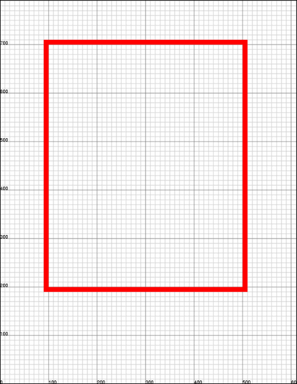

# Coordinate Spaces

## General

ABCpdf uses the standard Adobe PDF coordinate space. The origin of this space is at the bottom left of the document. Distances are measured up and to the right in points. Points are a traditional measure for print work - there are 72 points in an inch.

**Please note that the bottom-up PDF coordinate space is different from the top-down coordinate system often used in Windows. It means that everything is based around the bottom left of objects - not the top left***.* If you wish to use a different coordinate system you can use the document [Units](../5-abcpdf/doc/2-properties/units.md), [TopDown](../5-abcpdf/doc/2-properties/topdown.md) or [Transform](../5-abcpdf/doc/2-properties/transform.md) to accomplish this.

ABCpdf uses the [XPoint](../5-abcpdf/xpoint/index.md) object to represent positions in space. It uses the [XRect](../5-abcpdf/xrect/index.md) object to represent areas like the current drawing area or the size of a page.

The [Doc.Rect](../5-abcpdf/doc/2-properties/rect.md) property is probably the most important property to be aware of. **Virtually everything happens within the Doc.Rect.** If you add text to a document it is added within the Doc.Rect. If you paint or frame a rectangle it is done within the Doc.Rect. If you add an image it is scaled to fit exactly within the Doc.Rect.

The default document size for ABCpdf is 612 by 792. This equates to a physical page size of 8.5 by 11 inches.

## Example

The following example draws a rectangle with the bottom left corner positioned 100 points from the left of the page and 200 points up from the bottom. The width of the rectangle is 400 points and the height is 500 points. We add a grid to show the positioning of the rectangle.

```csharp
Doc theDoc = new Doc();
theDoc.AddGrid();
theDoc.Color.String = "255 0 0";
theDoc.Width = 10;
theDoc.Rect.Position(100, 200);
theDoc.Rect.Width = 400;
theDoc.Rect.Height = 500;
theDoc.FrameRect();
theDoc.Save(Server.MapPath("coordinates.pdf"));
```

  
coordinates.pdf
