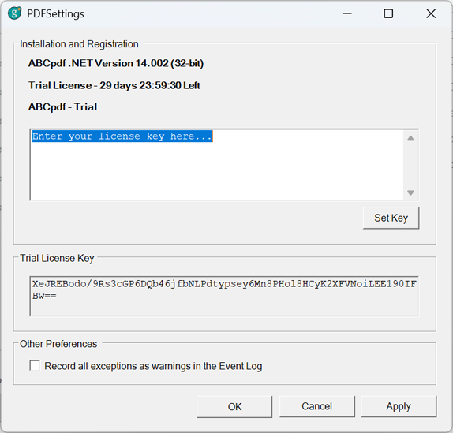

# ABCpdf on Linux

## Intro

The general ethos of ABCpdf is of design and development on Windows followed by deployment on Linux or Windows.

## Basics

You need Ubuntu 26.04, 24.04 or 22.04.

If you are using WSL you need to use WSL 2. WSL version 1 is not supported

By default, compared with Windows, Linux comes with a small number of fonts. You may wish to install new fonts at /usr/local/share/fonts, /usr/share/fonts or \~/.local/share/fonts.

Config is held in the file system. You can select a different config file using [XSettings.SetConfigFile](../5-abcpdf/xsettings/1-methods/setconfigfile.md). Temp files are held at /tmp/ABCpdf.

## Docker

Docker example projects for ABCpdf may be found on GitHub.

Here is an example project to show how to run ABCpdf as a containerized microservice using a Docker image based on Ubuntu 22.04 LTS. This allows in-container debugging in Visual Studio 2022 and later.

[ABCpdf-Team / APCpdfLinuxContainer](https://github.com/ABCpdf-Team/APCpdfLinuxContainer)

You may wish to use this as a template for your own ABCpdf-powered microservice.

## Licenses

There are no trial licenses created on Linux so you need to set a license in your code.

At application startup simply call [XSettings:InstallLicense](../5-abcpdf/xsettings/1-methods/installlicense.md) with a license key. You can use a trial license key copied from the PDFSettings application on Windows or with a purchased license key.

The PDFSettings application is available in the full Windows MSI installation. Download and run the MSI from our site and then look under the ABCpdf menu item for the PDFSettings app. Open it and you will see a trial license key - an alphanumeric string about a hundred characters long. You can use this in your code.



## .NET Install

Linux does not come with the .NET runtime pre-installed.

If you have not installed it and you try to publish with self-contained false, then you will get an error when you try and run the executable. Something similar to this.

```
You must install .NET to run this application.

App: /home/pcuser/helloworld/helloworld
Architecture: x64
App host version: 6.0.22
.NET location: Not found
```

Publishing with self-contained true is a good alternative if your chosen runtime is not easily available on your distro. It increases the output size by about 60 MB but provides a simple solution.

Details of how to install the runtime may be found [here](https://learn.microsoft.com/en-us/dotnet/core/install/linux). If you are using .NET 10 you might need the following. However the process does vary by platform so you may need to check the Microsoft documentation.

```
sudo apt update
sudo apt install dotnet-runtime-10.0
```

If you are using ABCChrome then you may need to install a few extra packages.

```
# for Ubuntu 22 and 23
sudo apt install -y libasound2 libnss3 libcurl4

# for Ubuntu 24 to 26
sudo apt install -y libasound2t64 libnss3 libcurl4t64

# for Ubuntu 22 only - not needed on 23 to 26
sudo apt install -y xserver-xorg-core --no-install-recommends --no-install-suggests
sudo apt install -y libcairo2 libatk1.0-0 libatk-bridge2.0-0 libcups2 libxcomposite1 libxdamage1 libxrandr2 libxkbcommon0 libpango-1.0-0
```

While ABCpdf does not officially support Debian Linux, here are the additional packages ABCChrome requires.

```
# for Debian Linux 12.7 - much the same as Ubuntu 22
sudo apt install -y libasound2 libnss3 libcurl4
sudo apt install -y xserver-xorg-core --no-install-recommends --no-install-suggests
sudo apt install -y libcairo2 libatk1.0-0 libatk-bridge2.0-0 libcups2 libxcomposite1 libxdamage1 libxrandr2 libxkbcommon0 libpango-1.0-0
# and also...
sudo apt install -y libglib2.0-0
```

While ABCpdf does not officially support Fedora Linux, here are the additional packages ABCChrome requires.

```
# for Fedora Linux 40
sudo dnf install -y alsa-lib mesa-libgbm cairo atk at-spi2-atk cups-libs libXcomposite libXdamage libXrandr pango
```

As always a judicious use of ldd will reveal any other missing packages you may require. Run against files like libABCpdf14-64.so and libChakraCore64.so but also against the ABCChrome146/ABCChrome146 executable if you are using the ABCChrome HTML engine.

## WSL

If you are using WSL you must use WSL 2. WSL version 1 is not supported.

WSL 2 is not fast when it comes to file access across the OS divide. Operations such as validating the ABCChrome install require checksums to be calculated on large files. These take a fraction of a second if your files are located on the same OS file system. However if they are located on the Windows file system (paths such as /mnt/c) they can take many seconds.

WSL 1 is much faster here but there are parts missing which can lead to subtle problems. For example in WSL 1 there is no range based file locking. Without file locking it is difficult to be sure that files will get synchronized correctly. Similarly WSL 1 does not support some memory mapping operations which means that some complex HTML conversion operations may fail.

In many situations things will work, but when they go wrong the problems will be small and subtle and impossible to fix. That is why we do not support WSL 1.

## NuGet

The ABCpdf NuGet package contains core libraries for Windows and Linux.

The name of the ABCpdf assembly it adds to your project varies with the framework you target. For the full list of files see [Manual Installation](../3-concepts/6-installation.md).

The standard ABCpdf NuGet package includes ABCChrome for Windows but not for Linux because the package is quite large.

If you want to use ABCChrome on Linux you need to reference the ABCpdf.ABCChrome146.Linux NuGet package as well as the ABCpdf one.

If you do not do this you will get an "Unable to find ABCChrome146" error when you run on Linux.

## Deployment

The NuGet package contains appropriate libraries but these will be specific to the platform on which you are running. To deploy to Linux you will need to do a command line publish.

On your Windows computer open a Visual Studio developer command prompt and then navigate using cd to the location of your project.

Here we will assume that you have a project called 'helloworld", that you have a WSL Linux installation called "Ubuntu" and a Linux user called "pcuser". Run the following to deploy the release build to your Linux installation. Here we deploy assuming that the .NET runtime is already installed. If your chosen .NET runtime is not easily available on your distro then you might prefer to set self-contained to true.

```
dotnet publish helloworld.csproj -r linux-x64 -c Release --self-contained false --output \\wsl.localhost\Ubuntu\home\pcuser\helloworld
```

You need to flag your compiled output as executable. Open up a bash shell by clicking in the Windows task bar search box and typing "bash". Enter the following.

```
cd ~/helloworld
dir # just a sanity check
sudo chmod +x helloworld
```

If you are deploying ABCChrome then you will need to flag that too.

```
sudo chmod +x ABCChrome146/ABCChrome146
```

Then run your executable to produce an output.

```
./helloworld
```

Sometimes WSL will create your files owned by root rather than as your pcuser. This is related to the way files are written from the Windows side to the Linux side. If this is the case you will get a permissions error and you will need to change the ownership. If you build from the Linux side permissions will be more straightforward.

```
sudo chown -R pcuser:pcuser /home/pcuser/helloworld
```

## Features

Because Linux does not offer the exact same capabilities as Windows there are some differences.

In general these differences relate to legacy code support which is not required on Linux or to Windows specific features such as MS Office interop.

- .NET 6.0+ on x64 are the supported platforms.
- ABCChrome146, ABCChrome123 & ABCChrome117 are the only HTML conversion engines.
- FireShield is not available.
- Some read modules are not available: XpsAny, MSOffice, OpenOffice, RichTextFormat and EmfVector.
- Exports which depend on WIC codecs (eg .dds, .heic, .heif, .jxr, .wdp) will not work.
- EMF import and export is not supported.
- Different fonts will be available so font substitution will be different.
- There may be subtle differences in the positioning of characters on the page.
- There may be subtle differences in the layout of bi-directional text.
- The TextOperation.ShowClippedText property is not functional.
- 3D Annotations are not rendered and appearances are not generated for them.
- WebGL export and embedded graphics are not supported.
- System.Drawing is not available on Linux, so APIs involving it do not function.
- The .so shared libraries are not signed because there are no mechanisms for this.
- The .NET cryptographic classes on Linux operate differently and with reduced functionality so some signature operations may fail.
- In case of error, exceptions may be different because Linux provides different error information from Windows.

You may see some differences between the ABCChrome HTML conversion on Windows and Linux. In general these are related to the rather minimal set of fonts available on Linux. If you wish your Linux output to be similar to your Windows output you will need to scatter fonts liberally. However there are some other more subtle and obscure differences too.

- Form text fields may appear a slightly different width.
- You cannot convert from a site with an invalid SSL certificate.
- Images added directly - ie not inside an HTML page - may appear a different size.
