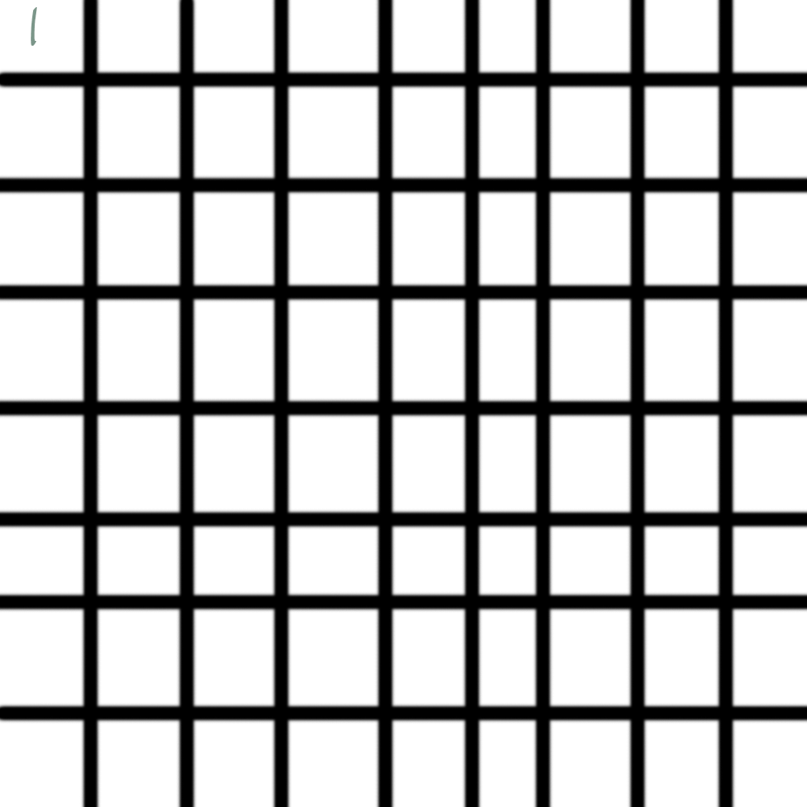
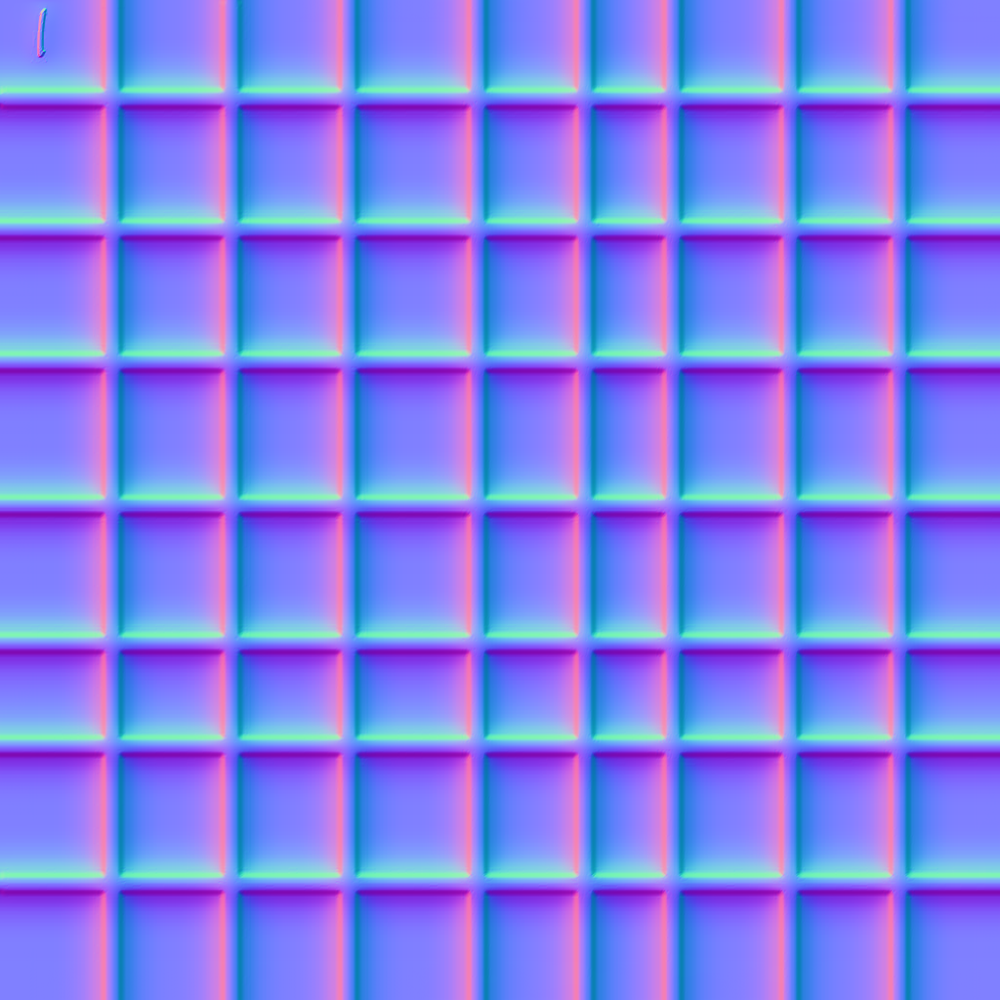
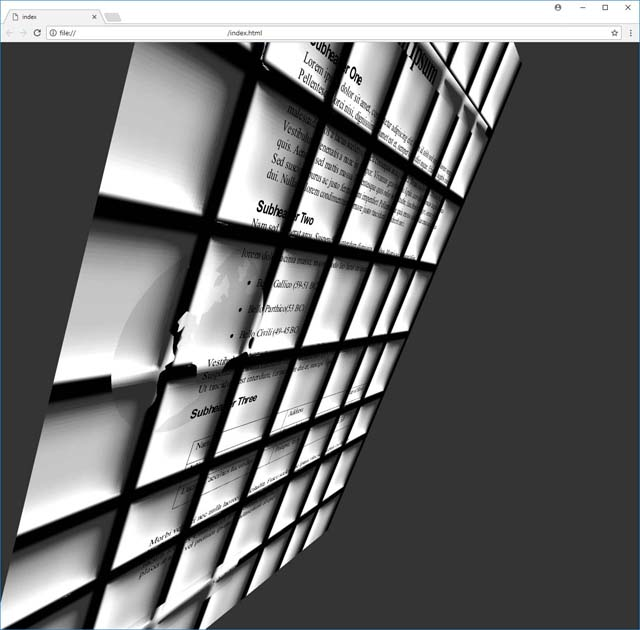

# PDF to WebGL Export

## Intro

ABCpdf allows to export PDF files to HTML with WebGL 3D content.

WebGL is a JavaScript API for rendering GPU-accelerated graphics. It uses a canvas object to render to, a JavaScript interface to interact with the graphics library, and an OpenGL Shader Language (GLSL) for code that is to be executed on the GPU.

Your browser needs to support WebGL 1.0 or later. All mainstream modern browsers do this. You can check your WebGL version at http://webglreport.com/

## Export

All you need to do is run code of the following form.

```csharp
doc.SaveOptions.EmbeddedGraphics = XSaveOptions.EmbeddedGraphicsType.Html5WebGL;
doc.SaveOptions.FontSubstitution = XSaveOptions.FontSubstitutionType.Always;
doc.Save("C:\webpage.htm");
```

This will produce a main generic output file.

- \<filename>.html - the main file, which can be opened in the browser. Contains the html head and body, including the canvas object which will be drawn to and the main javascript functionality necessary for WebGL. It does not contain any scene specific information so it could also be used as a template and the actual graphical content could be replaced.

It will also produce a sub folder containing various generic resource files.

- \<filename>/gl-matrix-2.3.2.min.js - third party functionality needed for doing matrix and vector calculations, see http://glmatrix.net/
- \<filename>/\<filename>.css - bare bones CSS file containing necessary styles for body and canvas elements in order to provide a better user experience
- \<filename>/viewcontroller.js - JavaScript file containing the functionality to move and rotate the camera and/or the model in 3D space (see below for more info)
- \<filename>/settings.js - JavaScript file containing general settings which can be modified by adding query strings to the URL in the browser (see below for more info)

Also files containing the actual 3D content as generated from the PDF.

- \<filename>/content_shaders.js - a JavaScript file containing the source code in the form of a JSON string for the GLSL shaders used to render the content. These shaders will be read upon loading of the page, and then compiled for and uploaded to the GPU. Each shader program consists of a vertex shader (executed on a per-vertex basis, to calculate and/or interpolate various values needed for rendering) and a fragment shader (executed on a per-fragment basis, which receives those calculated and interpolated values and calculates a final output color for each fragment)
- \<filename>/content_textures.js - a JavaScript file containing the source code in the form of a JSON string for the textures which are used for rendering the content. Each texture is stored as a base64 encoded string, and upon loading of the page will be encoded into a valid image type, from which a WebGL texture object will be created and uploaded to the GPU
- \<filename>/content_geometry.js - a JavaScript file containing all the actual geometry that is to be rendered (and some other objects needed for rendering) again stored in the form of a JSON string

The format of multi line JSON strings inside .js files was chosen to overcome security limitations enforced by browsers, which do not permit loading local files. Choosing to store textures as image files would require a web server to be run in order to render the exported HTML file.

## Settings

The settings.js file allows control over the environment in which the model should be shown.

You can control these via URL query strings. For example.

```
webpage.htm?showAxis=true&showNormals=true
```

The settings which can be modified are:

- backgroundColor = R,G,B - allows modifying the background color by settings an array; important: It has to be 3 numerical values in the range of \[0,1\] for each of the color components (red, green, blue) separated by a comma (',')
- enableTransparency = true/false - default enabled, but allows disabling transparency, but will only result in different rendering if the content actually has transparency
- wireframe = true/false - allows rendering a pseudo-wireframe which can help illustrate the triangles of which the content is made (Note: it is technically not a correct wireframe, as all it does is just render the triangles as line sets instead of triangles - a technically correct wireframe is more easily implemented using geometry shaders, which are not supported in WebGL 1)
- backfaceCulling = true/false - allows disabling rendering of the "backside" of triangles, so in case of a PDF page, if the camera is viewing it's backside it will simple draw nothing
- enableDepthSorting = true/false - allows en/disabling depth sorting, which is only really relevant in "true 3D" content, but won't show a visible difference on a 3D-rendered PDF page
- orthoView = true/false - by default the content is rendered in a perspective projection (edges of the same length will be rendered at a different size depending on their distance to the viewer), but with this settings it can be rendered in an orthogonal projection, which results in edges of the same length being rendered the same size regardless of the distance to the viewer (which can result in a distorted look)
- defaultPerspectiveFOV = \<angle in degrees> - allows setting the field of view angle for the scene, default is a 45 degree cone (will not affect orthogonal projections)
- nearClip = \<distance in units> - allows setting the distance of the near clipping plane of the view frustum (objects closer to the camera than this value will result in being clipped)
- farClip = \<distance in units> - allows setting the distance of the face clipping plane of the view frustum (objects further than that will not be drawn)
- defaultViewDistance = \<distance in units> - allows settings the default distance of the viewer (camera) from the subject
- showAxis = true/false - allows showing the main axis in the rendered world, centered at the origin; x-Axis is red, y-Axis is green, and z-Axis is blue with the positive axis being a brighter hue than the negative axis
- axisScale = \<value> - allows changing the size of the axis that is being rendered, default is 300
- showGrid = true/false - allows rendering a grid in the world, centered around the origin and lying in the XZ-plane
- gridScale = \<value> - allows changing the size of the grid that is being rendered, default is 1000
- gridColor = R,G,B - allows modifying the color of the grid, like in background color by comma-separated red, green and blue values, each in the range of \[0,1\]
- showNormals = true/false - allows rendering "normals" (vectors perpendicular the to triangles they belong to), which can help visualizing and understanding the lighting effects more
- normalColor = R,G,B - allows modifying the color of the normals, by comma-separated red, green and blue values, each in the range of \[0,1\]
- normalScale = \<value> - allows modifying the size of the rendered normals, default is 100
- enableLight = true/false - allows switching the light source on/off; if off the object will be drawn full-bright using it's normal object colors, if the light is enabled, it will use a single infinite-distance directional light source (similar to the sun) to light the scene, and the brightness of the objects depends on their direction relative to the light source
- enableAmbient = true/false - allows en/disabling an ambient light source (so that for example the side which is pointing away from the light source won't just appear black but will be lit a bit as well)
- enableSpecular = true/false - allows en/disabling specular highlights on the objects; depending on the position of the viewer relative to the object and light source, a specular reflection might make parts of the object brighter
- lightPosition = X,Y,Z - allows setting the position of the light; the directional light will then "shine" in the direction from this position towards the origin, therefore the actual distance from the object does not matter, only the direction
- lightAmbient = R,G,B - allows setting the brightness and color of the ambient light (if enabled)
- lightDiffuse = R,G,B - allows setting the brightness and color of the main light source (diffuse light)
- lightSpecular = R,G,B - allows setting the brightness and color of the specular reflection (to simulate how different materials might reflect light differently); to provide a consistent lighting model, the ambient, diffuse and specular colors should have the same hue (but can have different brightness)
- allowDynamicView = true/false - allows en/disabling of view modifications; if false the result will be the same as rendering a static page
- allowMouseWheelZoom = true/false - if true, the view can be zoomed in/out using the mouse wheel
- mouseWheelIncrement = \<value> - allows setting the amount of zoom applied by the mouse wheel with each movement, default is 50
- moveKey = "\<keyname>" - the key modifier to use to allow translating (moving) the object (while left-clicking and dragging the mouse), default "Shift"
- zoomKey = "\<keyname>" - the key modifier to use to allow zooming in/out (while left-clicking and dragging the mouse), default "" (disabled)
- resetKey = "\<keyname>" - the key modifier to use to reset the view to original direction, and return the object to it's original position, default "Home"
- modelRotateKey = "\<keyname>" - the key modifier to use to allow rotating the object (rather than the camera) while left-clicking and dragging the mouse, default "Control"
- allowQWEASDRotation = true/false - whether to enable the keys Q, W, E, A, S, D for rotating the object in 90 degree increments around the x, y or z-Axis (A,D = +-90 deg on x-Axis, W,S = +-90deg on y-Axis and Q,E = +-90deg on z-Axis); mostly used for debugging purposes, default disabled

## View & Model

Rotate View:

If the dynamic view is enabled (settings 'allowDynamicView' set to true, see above) the viewpoint (camera) can be rotated by left-clicking into the canvas object (which fills the body of the html page, so clicking anywhere into the page will start a rotation) and dragging the mouse. Depending on where in the scene the user clicks, the rotation might be different, further away from the center of the scene will result in a rotation around the axis the camera is sitting on (the z-axis pointing "out of the screen").

Zoom View:

lf the mouse wheel is enabled ('allowMouseWheelZoom' set to 'true') the view can be zoom by using the mouse wheel (the amount of zoom is set in the 'mouseWheelIncrement' setting), alternatively the view can also be zoomed if a 'zoomKey' is set. In that case the user needs to hold that key, and can zoom with left-click dragging the mouse.

Rotate Model:

If the 'modelRotateKey' is set, the model can be rotated while holding down that key, and left-click dragging the mouse. This rotates the model around it's origin  
Alternatively, if 'allowQWEASDRotation' is set to 'true' the user can also rotate the view around the model's 3 axis in 90 degree increments, using the A, D (for x-axis rotation), W, S (for y-axis rotation) and Q, E keys (for z-axis rotation)

Move Model:

If the 'moveKey' is set, the model can be moved (translated) while holding down that key, and left-click dragging the mouse. The movement is along the plane of the screen (rather than the world coordinate system).

## Lighting

The WebGL renderer uses a simple lighting model (see 'enableLight' setting) with a single directional light source (see 'lightPosition' setting).

The strength and color of the light source can be set with the 'lightDiffuse' setting, and an ambient light can be added to provide some light for the parts of the model that are facing away from the light source ('enableAmbient' and 'lightAmbient' settings).

The directional light source can also result in a specular highlight (simulating a reflection of the light) on the surface, which -depending on the orientation of the model and the viewer- can make parts of the model brighter (use 'enableSpecular' and 'lightSpecular' settings to control this effect). The specular highlight is calculated using the simple Blinn-Phong model.

## Materials

The geometry information stores material information, which affects the light output. The material can have four properties:

- "specular" - describes a color, which affects the specular highlight; this simulates that different materials could reflect light in different ways (for example by filtering out color components)
- "opacity" - whether the material is transparent to a certain degree, or fully opaque
- "shininess" - how the specular highlight will show up on the surface (depending on how shiny a material it is, it can be a small very focused reflection, or a big "blobby" and more diffuse reflection)
- "doublesided" - whether both sides of the material are rendered or only one side; at the moment -for slightly more realism- only the "page" object itself is rendered on both sides, but the text, images etc on the page are only rendered on the "front side" of the "page"

Currently a default diffuse texture, affecting the calculation of the diffuse part of the lighting model, is applied to the model representing the PDF "page" in order to give it a less flat appearance.

Additionally a normal map is used to simulate unevenness of the object surface, and this normal map is applied to both the "page" and all the objects rendered on the page - images and text, and graphical objects like curves etc.

This normal map essentially replaces the normal information that is stored with the triangles that make up the geometry (those triangles have normals that are perpendicular to the plane of the triangle, to simulate a flat surface), and are basically just a texture (image object) which encodes the normals on a per-fragment basis into a color code to make up an image.

As the normals of a surface are supposed to be unit vectors of length 1, it means the individual components of each vector describing the normal will always be in the range of \[-1,1\]. As the color components of a pixel for the Red, Green, and Blue components are expected in the range \[0,1\], it means the normals need to be encoded by adding 1 and dividing the result by 2 to normalize them into the \[0,1\] range.

This texture then gets loaded by the GPU, and at rendering time it will look up the texture coordinate for the currently processed fragment, and translate the color into a normal (by reversing the above calculation), and apply this normal instead of the triangle normal. This results in the surface getting a more uneven and realistic look.

## Custom Textures

You can use your own page textures and normal maps by dropping them into the export destination folder. ABCpdf will look for files named:

- "diffuse_texture.\<ext>" - to be used for the page diffuse texture (may be .jpg, .jpeg or .png)
- "normal_texture.\<ext>" - to be used for the normal map (may be .jpg, .jpeg or .png)

Textures you can make yourself using Photoshop filters. Normals can be created using the Photoshop 3D filters. For example.

Given the following texture.

  
diffuse_texture.png

And normal map.

  
normal_texture.png

This is the kind of output you might expect.

  
webgl_screenshot.png
