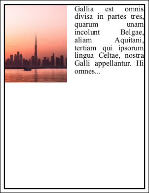

# Text Flow Round Image Example

This example shows how to flow text around an image. The techniques shown here may be used in conjunction with the [Text Flow](02-textflow.md) example which shows how to flow text between areas on the same or different pages.

## Setup

First we'll set up a convenient variable to contain the text we want to display.

```csharp
// text truncated for clarity
string text = "Gallia est omnis divisa in partes tres, quarum unam incolunt Belgae, aliam Aquitani, tertiam qui ipsorum lingua Celtae, nostra Galli appellantur. Hi omnes...";
```

## Doc Obj

Next we create an ABCpdf Doc object and give it our basic settings.

We enlarge the line width, increase the font size, enable justification and inset the drawing rectangle from the edges of the document.

```csharp
using var doc = new Doc();
doc.Width = 4;
doc.FontSize = 32;
doc.TextStyle.Justification = 1;
doc.Rect.Inset(20, 20);
```

## Image

We save the rect since we're going to need it later. Then we add an image to the left hand side of the page. This is the image we are going to flow around.

```csharp
string saveRect = doc.Rect.String;
using var xi = XImage.FromFile("../mypics/pic.jpg", null);
doc.Rect.Resize(xi.Width / 2, xi.Height / 2, XRect.Corner.TopLeft);
doc.AddImage(xi);
```

## Text

The crucial part occurs here which is where we set up the variable left margins to ensure that our text is shifted away from the image. If we had images on the right we would want to use variable right margins too. But here it is not necessary.

```csharp
double padX = doc.FontSize;
double padY = doc.FontSize / 3.0;
string format = "<stylerun justification=\"1.0\" leftmargins=\"0 {0} {1}\">";
string style = string.Format(format, doc.Rect.Height + padY, doc.Rect.Width + padX);
```

## Save

After adding and framing our text we save the document to a specified location and clear our document.

```csharp
doc.Rect.String = saveRect;
doc.FrameRect();
int id = doc.AddTextStyled(style + text + "</stylerun>");
doc.Save("textflowroundimage.pdf");
```

## Results

  
textflowroundimage.pdf
