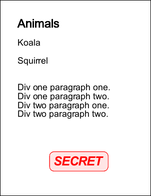

# Tagged Text Example

This example shows how to add text to a PDF document tagged appropriately for PDF/UA.

## Setup

First create an ABCpdf Doc object and add some parts for PDF/UA. You need to have a title so we will add one and we will set the language to British English. You can skip these things if you only need a tagged document rather than a PDF/UA compliant one.

```csharp
using var doc = new Doc();
var st = doc.Tag.GetStructure();
st.CreateAsRequired();
st.Title = "Tagged Document";
st.Root.AddKid("Document").EntryLang = "en-GB";
```

## Doc Obj

Next we add a font and some styles and set the drawing area to be inset from the page edges.

We set the auto-tagging to true and add some text. For most purposes you will never need to do more than this.

```csharp
doc.Font = doc.EmbedFont("Arial");
doc.TextStyle.Size = 36;
doc.Page = doc.AddPage();
doc.Rect.Inset(72, 72);
doc.TextStyle.AutoTag = true;
doc.AddTextStyled("<h1 fontsize=48>Animals<h1><p>Koala<p><p>Squirrel<p>");
```

## Image

However if you have more complex requirements you may want finer grained control over the tagging process. Here we put our next items of text inside different Div and P (paragraph) tags.

```csharp
doc.Pos.Y -= 72;
doc.Tag.Open("Sect", "Div", "P");
doc.AddText("Div one paragraph one.\r\n");
doc.Tag.CloseOpen("P");
doc.AddText("Div one paragraph two.\r\n");
doc.Tag.Close("P", "Div");
doc.Tag.Open("Div", "P");
doc.AddText("Div two paragraph one.\r\n");
doc.Tag.CloseOpen("P");
doc.AddText("Div two paragraph two.\r\n");
doc.Tag.Close("P", "Div", "Sect");
```

## Text

Sometimes you may need to link in a standalone object such as an Annotation. Here we create a new tag role called "RubberStamp" and assign it some style attributes. Then we create a tag using those settings, a stamp annotation, add it to the tag and then assign it to the document.

```csharp
doc.Tag.Roles["RubberStamp"] = "Annot";
doc.Tag.Classes["RedBorder"] = Atom.FromString("<< /O /Layout /BorderColor [1 0 0] /BorderStyle /Solid >>");
var graphic = doc.Tag.MakeTag("RubberStamp");
graphic.Attributes = new DictAtom();
graphic.Attributes["Alt"] = new StringAtom("Classification: Secret");
graphic.Attributes["C"] = new NameAtom("RedBorder");
graphic.Object = new StampAnnotation(doc, XRect.FromLbwh(200, 100, 200, 80), "SECRET", XColor.FromRgb(255, 0, 0));
doc.Tag.OpenClose(graphic);
```

## Save

Finally we save the document and export the document structure.

```csharp
doc.Save("taggedtext.pdf");
st.UpdateActualText(true, true);
var txt = st.ExtractStructure();
File.WriteAllText("taggedtext.txt", txt.ToString());
```

## Results

  
taggedtext.pdf

The output tag structure from the ExtractStructure call will be something like this,

```
<Root ObjID="4">
        <Document ObjID="7">
                <H1 PageNumber="1" ObjID="47">
                        <ActualText>Animals</ActualText>
                        <MCID ID="0" />
                </H1>
                <P PageNumber="1" ObjID="48">
                        <ActualText>Koala</ActualText>
                        <MCID ID="1" />
                </P>
                <P PageNumber="1" ObjID="49">
                        <ActualText>Squirrel</ActualText>
                        <MCID ID="2" />
                </P>
                <Sect PageNumber="1" ObjID="50">
                        <Div PageNumber="1" ObjID="51">
                                <P PageNumber="1" ObjID="52">
                                        <ActualText>Div one paragraph one.</ActualText>
                                        <MCID ID="3" />
                                </P>
                                <P PageNumber="1" ObjID="53">
                                        <ActualText>Div one paragraph two.</ActualText>
                                        <MCID ID="4" />
                                </P>
                        </Div>
                        <Div PageNumber="1" ObjID="54">
                                <P PageNumber="1" ObjID="55">
                                        <ActualText>Div two paragraph one.</ActualText>
                                        <MCID ID="5" />
                                </P>
                                <P PageNumber="1" ObjID="56">
                                        <ActualText>Div two paragraph two.</ActualText>
                                        <MCID ID="6" />
                                </P>
                        </Div>
                </Sect>
                <RubberStamp PageNumber="1" ObjID="57">
                        <ObjectReference ID="32" Type="StampAnnotation" />
                </RubberStamp>
        </Document>
</Root>
```
