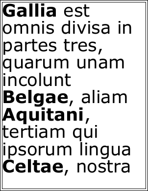

# Multistyle Example

This example shows how to create multistyled text.

## Setup

We want to display all our proper names in bold so we enclose them in bold tags.

```csharp
string text = "<b>Gallia</b> est omnis divisa in partes tres, quarum unam incolunt <b>Belgae</b>, aliam <b>Aquitani</b>, tertiam qui ipsorum lingua <b>Celtae</b>, nostra <b>Galli</b> appellantur.";
```

## Doc Obj

Next we create an ABCpdf Doc object and give it some basic settings. Although we could pass our styled text directly to the AddTextStyled function, we can take more control over the way that fonts are added to the PDF if we specify font IDs.

```csharp
using var doc = new Doc();
doc.FontSize = 72;
doc.Rect.Inset(10, 10);
doc.FrameRect();
int font1 = doc.EmbedFont("Verdana", LanguageType.Latin, false, true);
int font2 = doc.EmbedFont("Verdana Bold", LanguageType.Latin, false, true);
```

## Adding

We replace the bold tags with font tags that directly reference our chosen fonts and then add the styled text to the current rectangle.

```csharp
text = "<font pid=" + font1.ToString() + ">" + text + "</font>";
text = text.Replace("<b>", "<font pid=" + font2.ToString() + ">");
text = text.Replace("</b>", "</font>");
doc.AddTextStyled(text);
```

## Save

Finally we save and clear the document.

```csharp
doc.Save("styles.pdf");
```

## Results

  
styles.pdf
