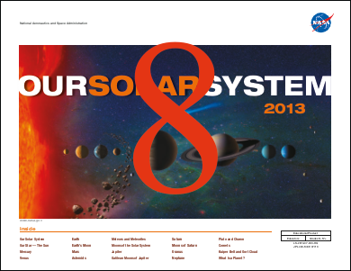

# Deletion Example

This example shows how to delete pages from a PDF document.

## Setup

First we create an ABCpdf Doc object and read our source document. We store the number of pages we're going to delete - we're going to delete all but one.

```csharp
using var doc = new Doc();
doc.Read("../mypics/sample.pdf");
int count = doc.PageCount - 1;
```

## Delete

We go round a loop deleting the second page each time.

```csharp
for (int i = 0; i < count; i++) {
  doc.PageNumber = 2;
  doc.Delete(doc.Page);
}
```

## Save

We add some text to the PDF so that we know how many pages we've deleted. Finally we save the PDF.

```csharp
doc.FontSize = 500;
doc.Color.String = "255 0 0";
doc.TextStyle.HPos = 0.5;
doc.TextStyle.VPos = 0.3;
doc.AddText(count.ToString());
doc.Save("deletion.pdf");
```

## Results

  
deletion.pdf
