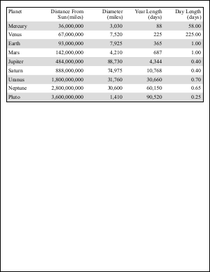

# Small Table Example

This example shows how to draw a single page table. ABCpdf does not provide table drawing routines itself so this example uses a Table Class to position the table elements.

You can find the full project and classes under the ABCpdf menu item. The project includes code for laying out a small table, a large table spreading over more than one page, an invoice and a product list.

## Setup

We start by creating our document object and reading the data for our table. For the purposes of this example we'll assume that our data is in a standard tab delimited format.

```csharp
string text = File.ReadAllText("../Rez/text6.txt");
using var doc = new Doc();
// set up document
doc.FontSize = 16;
doc.Rect.Inset(20, 20);
```

## Rotate

We create a new table object passing in values to tell it what rectangle it can occupy (it takes the current document rectangle) and how many columns of data it should be prepared for.

Columns are assigned relative widths and expand horizontally to fit the table rectangle. Here we're specifying five columns.

Most of our columns will be right aligned so we set the default horizontal alignment to 1.

```csharp
var table = new PDFTable(doc, 5);
table.CellPadding = 5;
table.HorizontalAlignment = 1;
```

## Add

We iterate through the table data adding rows as we go. We override the right alignment for the first column and we shade alternating rows using a light gray color. Finally we frame the table and save the document.

```csharp
text = text.Trim();
text = text.Replace("\r\n", "\r");
string[] theRows = text.Split([ '\r' ]);

for (int i = 0; i < theRows.Length; i++) {
  table.NextRow();
  string[] theCols = theRows[i].Split([ '\t' ]);
  theCols[0] = "<stylerun hpos=0>" + theCols[0] + "</stylerun>";
  table.AddTextStyled(theCols);
  if ((i % 2) == 1)
    table.FillRow("220 220 220", i);
}
table.Frame();
doc.Save("table1.pdf");
```

## Results

Using the following input data:

```
Planet Distance From Sun (miles) Diameter (miles) Year Length (days) Day Length (days)
Mercury 36,000,000 3,030 88 58.00
Venus 67,000,000 7,520 225 225.00
Earth 93,000,000 7,925 365 1.00
Mars 142,000,000 4,210 687 1.00
Jupiter 484,000,000 88,730 4,344 0.40
Saturn 888,000,000 74,975 10,768 0.40
Uranus 1,800,000,000 31,760 30,660 0.70
Neptune 2,800,000,000 30,600 60,150 0.65
Pluto 3,600,000,000 1,410 90,520 0.25
```

We get the following output.

  
table1.pdf
