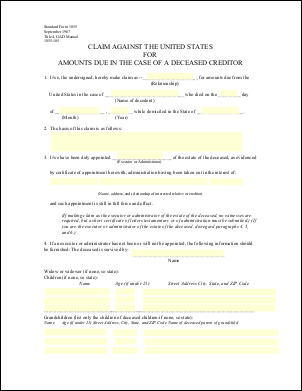
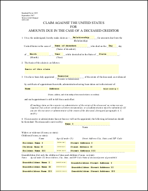

# eForm Fields Example

This example shows how to change the values of eForm fields. In this example we simply replace each of the fields in a form with the name of that field.

## Src

First we create an ABCpdf Doc object and read in our template form.

```csharp
using var doc = new Doc();
doc.Read("../mypics/form.pdf");

doc.Form.NeedAppearances = false; // for PDF 2.0
```

## Add

We iterate through each of the top level fields. For each field we set the value of the field to be equal to the value of the name.

```csharp
string[] names = doc.Form.GetFieldNames();
foreach (string theName in names) {
  var field = doc.Form[theName];
  field.Value = field.Name;
}
```

## Save

Finally we save.

```csharp
doc.Save("eformfields.pdf");
```

## Results

Given the following document.

  
form.pdf

This is the kind of output you might expect.

  
eformfields.pdf
