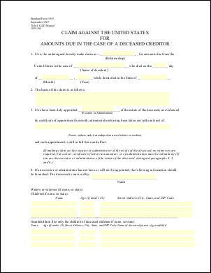
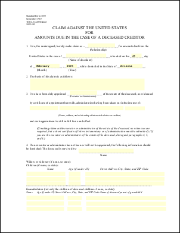

# eForm Stamp Example

This example shows how to stamp eForm fields into a document so that the values are indelibly marked

## Src

First we create an ABCpdf Doc object and read in our template form.

```csharp
using var doc = new Doc();
doc.Read("../mypics/form.pdf");
doc.Form.NeedAppearances = false; // for PDF 2.0
doc.Font = doc.AddFont("Helvetica-Bold");
```

## Add

We set the values of selected fields and then we stamp all field values into the document.

```csharp
doc.Form["Day"].Value = "23";
doc.Form["Month"].Value = "February";
doc.Form["Year"].Value = "2005";
doc.Form["State"].Value = "Arizona";
doc.Form.Stamp();
```

## Save

Finally we save.

```csharp
doc.Save("eformstamp.pdf");
```

## Results

Given the following document.

  
form.pdf

This is the kind of output you might expect.

  
eformstamp.pdf
