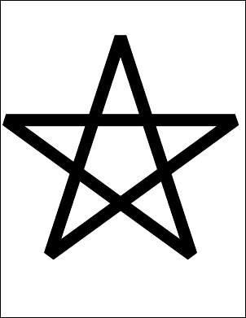
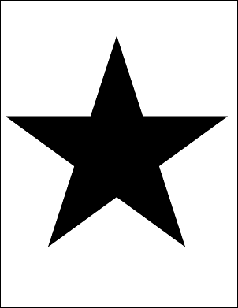
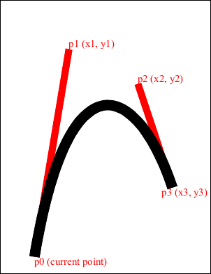
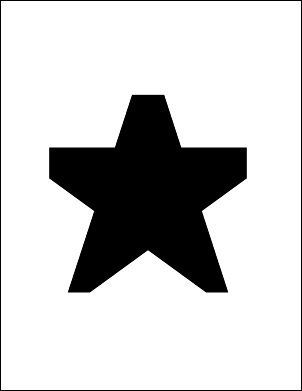
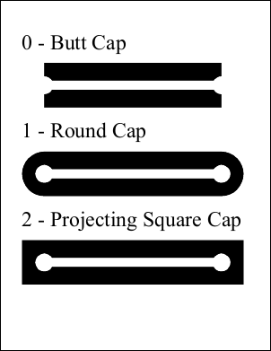
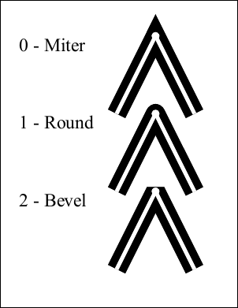
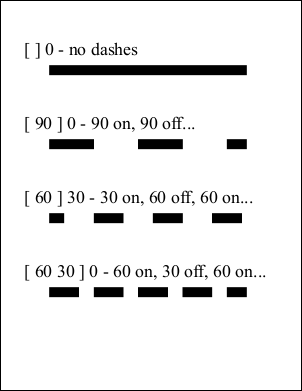
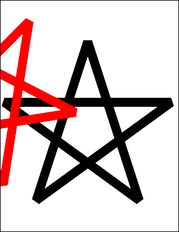

# Advanced Graphics Example

## Intro

Virtually all the drawing operations you will require are achievable using methods such as [FrameRect](../5-abcpdf/doc/1-methods/framerect.md), [FillRect](../5-abcpdf/doc/1-methods/fillrect.md), [AddLine](../5-abcpdf/doc/1-methods/addline.md) and [AddArc](../5-abcpdf/doc/1-methods/addarc.md).

However occasionally you may require more sophisticated control over your drawing operations. In these situations you need direct access to the PDF Content Stream.

## Content

Page content is defined by the page Content Stream. The Content Stream is a sequence of descriptions of graphics objects to be placed on the page. ABCpdf allows you to create or modify these content streams allowing you access to the full power of PDF drawing operators.

It was intentionally decided not to encapsulate this type of drawing within a closed API. Instead these examples are provided as source code. This allows you to adapt the classes to your needs.

You can find the full project and classes under the ABCpdf menu item.

Here we describe how to perform common tasks. We do not cover the entire range of possible operators and functions. For full details you should see the [Adobe PDF Specification](http://partners.adobe.com/).

## Paths

A path object is a shape made up of straight lines, rectangles and Bézier curves. It may intersect itself and may have disconnected sections and holes. After the path has been defined it may be painted, filled, used for clipping or a combination of these operations.

Each path is constructed of one or more subpaths. Each subpath is constructed of one or more connected segments. Subpaths may be open or closed. When a subpath is closed the start of the path is connected to the end.

All paths are located in the standard [Adobe PDF coordinate space](../2-getting_started/3-coordinates.md). The following is a list of standard path construction operators.

| Name | Parameters | Operator | Description |
| --- | --- | --- | --- |
| Move | x y | m | Begin a new subpath by moving to the coordinates specified. |
| Line | x y | l | Add a straight line from the current location to the coordinates specified. |
| Rect | x y w h | re | Add a rectangular subpath with the lower left corner at (x, y) with width w and height h. |
| Bézier | x1 y1 x2 y2 x3 y3 | c | Add a Bézier curve from the current location to the coordinates specified (x3, y3) using the other coordinates (x1, y1) and (x2, y2) as control points. |
| Close |  | h | Close the current subpath joining the start to the end. |
| Stroke |  | S | Paint a line along the current path using the current stroke color. |
| Fill |  | f | Fill the current path using the current fill color.<br>This fill method uses the nonzero winding number rule. There are other PDF operators to allow the use of the even-odd rule but these are not generally useful. |
| Clip |  | W n | Intersect the path with the current clipping path to establish a new clipping path.<br>This actually comprises two operators rather than one but they are almost invariably used in this combination. |

## State

The graphics state defines the parameters within which the PDF operators work. For example the graphics state defines the current line width which will be used whenever a line is drawn. It also defines the current non-stroking color which will be used whenever a path is filled.

You can push copies of the graphics state onto a stack and then restore them later. This can be very useful for doing and undoing graphics state operations.

| Name | Parameters | Operator | Description |
| --- | --- | --- | --- |
| Save State |  | q | Push a copy of the current graphics state onto the stack. |
| Restore State |  | Q | Restore the current graphics state from the top of the stack. |
| SetLineWidth | v | w | Set the width to be used when stroking lines. |
| SetGrayStrokeColor | w | G | Set the gray level to use for stroking operations.The component ranges between 0.0 and 1.0 (black and white respectively). |
| SetGrayNonStrokeColor | w | g | The same as G but for non-stroking operations. |
| SetRGBStrokeColor | r g b | RG | Set the RGB color to use for stroking operations. Each component ranges between 0.0 and 1.0. |
| SetRGBNonStrokeColor | r g b | rg | The same as RG but for non-stroking operations. |
| SetCMYKStrokeColor | c m y k | K | Set the CMYK color to use for stroking operations. Each component ranges between 0.0 and 1.0. |
| SetCMYKNonStrokeColor | c m y k | k | The same as K but for non-stroking operations. |
| Transform | a b c d e f | cm | Concatenate matrix with the current transform matrix. Common transforms include:<br>• Translation: A matrix of the form \[1 0 0 1 tx ty\] shifts the coordinate system by tx horizontally and ty vertically.<br>• Scaling: A matrix of the form \[sx 0 0 sy 0 0\] scales the coordinate system by a factor of sx horizontally and sy vertically pinned at the origin.<br>• Rotation: A matrix of the form \[cos(ra) sin(ra) -sin(ra) cos(ra) 0 0\] rotates the coordinate system by the angle ra anti-clockwise around the origin.<br>• Skew: A matrix of the form \[1 tan(ra) tan(ra) 1 0 0\] skews the x and y axes by the angle ra. |
| SetLineCap | v | J | The line cap for the ends of any lines to be stroked. Possible values are:<br>1. Butt. The stroke is square at the end of the path and does not project beyond the end of the path.<br>2. Round. A semicircle is added at the end of the path projecting beyond the endpoints.<br>3. Projecting Square. The stroke is square but projects a distance of half the line width beyond the ends of the path. |
| SetLineJoin | v | j | The line join for the shape of joints between connected segments of a path. Possible values are:<br>1. Miter. The outer edges for the two segments are extended until they meet. This is the same way that wooden segments are joined to make a picture frame. If the segments meet at an overly steep angle a bevel join is used instead. The precise cut-off point is called the Miter Limit (see below).<br>2. Round. A pie slice is added to the junction of the two segments to produce a rounded corner.<br>3. Bevel. The two segments are finished with butt caps and any notch between the two is filled in. |
| SetMiterLimit | v | M | The maximum length of mitered line joins for paths.<br>The miter limit is expressed in terms of the ratio of the thickness of the line to the thickness of the join.<br>For example a value of 1.5 will allow the width of the line at the join to be up to one and a half times the thickness of the width of an individual line segment. |
| LineDash | a p | d | The dash pattern to use for stroked lines. The parameters include a - an array for the pattern and p - the phase of the dash. |

## Stroke

Paths can be stroked (drawn) using the current stroking color.

For example you might wish to draw a star.

```csharp
using (var doc = new Doc()) {
  var theContent = new PDFContent(doc);
  theContent.SaveState();
  theContent.SetLineWidth(30);
  theContent.SetLineJoin(2);
  theContent.Move(124, 158);
  theContent.Line(300, 700);
  theContent.Line(476, 158);
  theContent.Line(15, 493);
  theContent.Line(585, 493);
  theContent.Close();
  theContent.Stroke();
  theContent.RestoreState();
  theContent.AddToDoc();
  doc.Save("adv_star_draw.pdf");
}
```



## Fill

Paths can be filled with the current non-stroking color.

For example you might wish to construct a filled star.

```csharp
using (var doc = new Doc()) {
  var theContent = new PDFContent(doc);
  theContent.SaveState();
  theContent.SetLineWidth(30);
  theContent.SetLineJoin(2);
  theContent.Move(124, 158);
  theContent.Line(300, 700);
  theContent.Line(476, 158);
  theContent.Line(15, 493);
  theContent.Line(585, 493);
  theContent.Close();
  theContent.Fill();
  theContent.RestoreState();
  theContent.AddToDoc();
  doc.Save("adv_star_fill.pdf");
}
```



## Bézier

Paths can contain curved segments.

Curved segments are specified as cubic Bézier curves. These provide a flexible and practical way to draw curves and curved paths.

Each segment is defined by four points. The first point and the final point define the ends of the segment. The second and third points define the control points. The line is pulled towards the first control point as it leaves the start and it is pulled towards the second control point as it arrives at the end.

The easiest way to illustrate this is with an example. Note that in this example the Bézier curve takes relatively little code to define. Most of the code is related to illustrating how the control points affect the shape of the curve.

```csharp
using (var doc = new Doc()) {
  var theContent = new PDFContent(doc);
  theContent.SaveState();
  theContent.SetLineWidth(30);
  theContent.Move(100, 50);
  theContent.Bezier(200, 650, 400, 550, 500, 250);
  theContent.Stroke();
  theContent.RestoreState();

  // annotate Bezier curve in red
  doc.Color.String = "255 0 0";
  doc.Width = 20;
  doc.FontSize = 30;
  doc.Pos.String = "100 50";
  doc.AddText("p0 (current point)");
  doc.Pos.String = "200 650";
  doc.Pos.Y = doc.Pos.Y + doc.FontSize;
  doc.AddText("p1 (x1, y1)");
  doc.Pos.String = "400 550";
  doc.Pos.Y = doc.Pos.Y + doc.FontSize;
  doc.AddText("p2 (x2, y2)");
  doc.Pos.String = "500 250";
  doc.Pos.X = doc.Pos.X - doc.FontSize;
  doc.AddText("p3 (x3, y3)");
  doc.AddLine(100, 50, 200, 650);
  doc.AddLine(400, 550, 500, 250);
  theContent.AddToDoc();
  doc.Save("adv_bezier.pdf");
}
```



## Clip

You can use a path to define a clipping area.

The graphics state holds a clipping path that restricts the areas on the page which can be painted on. Marks falling within the clipping area will be displayed and those falling outside will not.

The default clipping path is the entire page. You can intersect the current clipping path with a new path using the clipping path operators.

You cannot expand a clipping path. Instead you must save the graphics state before applying your clipping path and then restore the graphics state after you have finished using it.

Here we fill a rectangle clipped by our star shape.

```csharp
using (var doc = new Doc()) {
  var theContent = new PDFContent(doc);
  theContent.SaveState();
  theContent.SetLineWidth(30);
  theContent.SetLineJoin(2);
  theContent.Move(124, 158);
  theContent.Line(300, 700);
  theContent.Line(476, 158);
  theContent.Line(15, 493);
  theContent.Line(585, 493);
  theContent.Clip();
  theContent.Rect(100, 200, 400, 400);
  theContent.Fill();
  theContent.RestoreState();
  theContent.AddToDoc();
  doc.Save("adv_star_clip.pdf");
}
```



## Caps

You can define the way that the end points of your paths are capped.

The following options are available:

Butt. The stroke is square at the end of the path and does not project beyond the end of the path.

Round. A semicircle is added at the end of the path projecting beyond the endpoints.

Projecting Square. The stroke is square but projects a distance of half the line width beyond the ends of the path.

This example shows how different line caps are drawn. Note that the line cap themselves take relatively little code to define. Most of the code is related to annotating the drawing so that you can see how the caps relate to the end points.

```csharp
using (var doc = new Doc()) {
  var theContent = new PDFContent(doc);
  theContent.SaveState();
  theContent.SetLineWidth(100);
  theContent.SetLineCap(0);
  theContent.Move(100, 600);
  theContent.Line(500, 600); // line
  theContent.Stroke();

  theContent.SetLineCap(1); // round cap
  theContent.Move(100, 400);
  theContent.Line(500, 400);
  theContent.Stroke();

  theContent.SetLineCap(2);
  theContent.Move(100, 200);
  theContent.Line(500, 200);
  theContent.Stroke();

  // add capped lines
  theContent.AddToDoc();

  // annotate capped lines
  doc.FontSize = 48;
  doc.Pos.String = "50 720";
  doc.AddText("0 - Butt Cap");
  doc.Pos.String = "50 520";
  doc.AddText("1 - Round Cap");
  doc.Pos.String = "50 320";
  int id = doc.AddText("2 - Projecting Square Cap");
  doc.Width = 20;

  doc.Color.String = "255 255 255";
  doc.AddLine(100, 200, 500, 200);
  doc.Rect.String = "80 180 120 220";
  doc.FillRect(20, 20);
  doc.Rect.String = "480 180 520 220";
  doc.FillRect(20, 20);
  doc.AddLine(100, 400, 500, 400);
  doc.Rect.String = "80 380 120 420";
  doc.FillRect(20, 20);
  doc.Rect.String = "480 380 520 420";
  doc.FillRect(20, 20);
  doc.AddLine(100, 600, 500, 600);
  doc.Rect.String = "80 580 120 620";
  doc.FillRect(20, 20);
  doc.Rect.String = "480 580 520 620";
  doc.FillRect(20, 20);
  doc.Color.String = "0 0 0";
  doc.Save("adv_linecap.pdf");
}
```



## Joins

You can define the way that your line segments are joined.

The following options are available:

Miter. The outer edges for the two segments are extended until they meet. This is the same way that wooden segments are joined to make a picture frame. If the segments meet at an overly steep angle a bevel join is used instead. The precise cut-off point is called the Miter Limit.

Round. A pie slice is added to the junction of the two segments to produce a rounded corner.

Bevel. The two segments are finished with butt caps and any notch between the two is filled in.

This example shows how different line joins are drawn. Note that the line joins themselves take relatively little code to define. Most of the code is related to annotating the drawing.

```csharp
using (var doc = new Doc()) {
  var theContent = new PDFContent(doc);
  theContent.SetLineWidth(50);
  theContent.SetLineJoin(0);
  theContent.Move(300, 500);
  theContent.Line(400, 700);
  theContent.Line(500, 500);
  theContent.Stroke();

  theContent.SetLineJoin(1);
  theContent.Move(300, 300);
  theContent.Line(400, 500);
  theContent.Line(500, 300);
  theContent.Stroke();

  theContent.SetLineJoin(2);
  theContent.Move(300, 100);
  theContent.Line(400, 300);
  theContent.Line(500, 100);
  theContent.Stroke();
  theContent.AddToDoc();

  doc.FontSize = 48;
  doc.Pos.String = "50 700";
  doc.AddText("0 - Miter");
  doc.Pos.String = "50 500";
  doc.AddText("1 - Round ");
  doc.Pos.String = "50 300";
  doc.AddText("2 - Bevel");
  doc.Width = 10;
  doc.Color.String = "255 255 255";
  doc.AddLine(300, 500, 400, 700);
  doc.AddLine(400, 700, 500, 500);
  doc.Rect.String = "390 690 410 710";
  doc.FillRect(10, 10);
  doc.AddLine(300, 300, 400, 500);
  doc.AddLine(400, 500, 500, 300);
  doc.Rect.String = "390 490 410 510";
  doc.FillRect(10, 10);
  doc.AddLine(300, 100, 400, 300);
  doc.AddLine(400, 300, 500, 100);
  doc.Rect.String = "390 290 410 310";
  doc.FillRect(10, 10);
  doc.Color.String = "0 0 0";
  doc.Save("adv_linejoin.pdf");
}
```



## Dash

You can define dashed lines.

The dash pattern is specified by a dash array and a dash phase. The dash array specifies the length of dashes and gaps. The dash phase specifies the distance into the array at which the line dashes should start.

When the lengths in the array are exhausted the dash pattern starts again at the beginning. You can use an empty array and zero phase to specify a solid line

Dashed lines can be applied to any kind of path including straight lines and curves. Each subpath in a path is treated separately - the dash phase starts at the beginning again.

This example shows how different line dash patterns are drawn.

```csharp
using (var doc = new Doc()) {
  var theContent = new PDFContent(doc);
  theContent.SaveState();
  theContent.SetLineWidth(20);
  theContent.LineDash("[ ] 0");
  theContent.Move(100, 650);
  theContent.Line(500, 650);
  theContent.Stroke();

  theContent.LineDash("[ 90 ] 0");
  theContent.Move(100, 500);
  theContent.Line(500, 500);
  theContent.Stroke();

  theContent.LineDash("[ 60 ] 30");
  theContent.Move(100, 350);
  theContent.Line(500, 350);
  theContent.Stroke();

  theContent.LineDash("[ 60 30 ] 0");
  theContent.Move(100, 200);
  theContent.Line(500, 200);
  theContent.Stroke();
  theContent.RestoreState();

  // annotate dashed lines
  doc.Color.String = "0 0 0";
  doc.FontSize = 36;
  doc.Pos.String = "50 710";
  doc.AddText("[ ] 0 - no dashes");
  doc.Pos.String = "50 560";
  doc.AddText("[ 90 ] 0 - 90 on, 90 off...");
  doc.Pos.String = "50 410";
  doc.AddText("[ 60 ] 30 - 30 on, 60 off, 60 on...");
  doc.Pos.String = "50 260";
  doc.AddText("[ 60 30 ] 0 - 60 on, 30 off, 60 on...");

  // add dashed lines
  theContent.AddToDoc();
  doc.Save("adv_dashes.pdf");
}
```



## XForms

You can define transforms which affect the world space.

A transform allows you to translate, scale, rotate, or skew objects. Multiple transforms can be concatenated so that you can perform a combination of these operations.

A transform is defined by six numbers. Common transforms include:

Translation: A matrix of the form \[1 0 0 1 tx ty\] shifts the coordinate system by tx horizontally and ty vertically.

Scaling: A matrix of the form \[sx 0 0 sy 0 0\] scales the coordinate system by a factor of sx horizontally and sy vertically pinned at the origin.

Rotation: A matrix of the form \[cos(ra) sin(ra) -sin(ra) cos(ra) 0 0\] rotates the coordinate system by the angle ra anticlockwise around the origin.

Skew: A matrix of the form \[1 tan(ra) tan(ra) 1 0 0\] skews the x and y axes by the angle ra.

This example shows how to apply a 45 degree rotation to a drawing of a star.

```csharp
using (var doc = new Doc()) {
  var star = new PDFContent(doc);
  star.Move(124, 108);
  star.Line(300, 650);
  star.Line(476, 108);
  star.Line(15, 443);
  star.Line(585, 443);
  star.Close();
  star.Stroke();

  var theContent = new PDFContent(doc);
  theContent.SaveState();
  theContent.SetLineWidth(30);
  theContent.SetLineJoin(2);
  theContent.AddContent(star);
  theContent.SetRGBStrokeColor(1, 0, 0);
  theContent.Transform(0.7, 0.7, -0.7, 0.7, 0, 0);
  theContent.AddContent(star);
  theContent.RestoreState();
  theContent.AddToDoc();
  doc.Save("adv_star_rotate.pdf");
}
```



## Other

Other examples including text operators, transparency modes and blend modes can be found in the example project.

You can find the full project and classes under the ABCpdf menu item.
