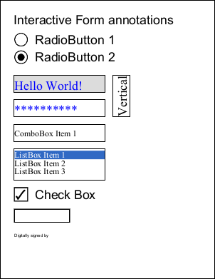
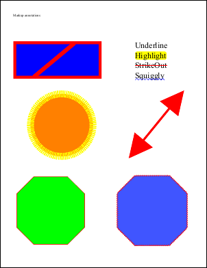
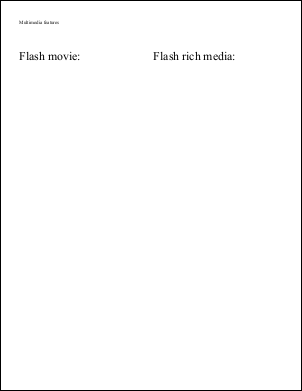
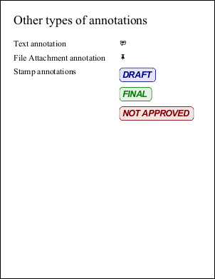

# Fields, Markup and Movies Example

## Intro

In general you will use PDF templates containing Fields and Annotations created by a designer.

However occasionally you may need to create Fields and Annotations at run-time. You can perform this kind of operation using the low level functionality within ABCpdf.

## Types

Annotations are a generic class of objects which exist outside the page Content Stream. Because they are independent of the PDF Content Stream they operate independently of the page. They float over it rather than being embedded in it.

Movie Annotations, Note Annotations, Stamp Annotations, Line Annotations and Polygon Annotations are just a few of the many Annotation types which exist.

Fields are a specific type of Annotation combined with a named value. It is the fact that the Field is an Annotation which allows you to see it and interact with it. It is the fact that the Annotation is linked into the Field hierarchy which allows it to take a value and be located by name.

Movies are a specific type of Annotation. You can embed a variety of movie formats including Flash and WMV.

Creating these types of objects on the fly is complex. For this reason the examples here are simple summaries. You can find a full project and classes under the ABCpdf menu item.

For full details of the way that Annotations work you should see the [Adobe PDF Specification](http://partners.adobe.com/).

## Fields

You may wish to generate a PDF document with Fields created dynamically at run-time.

The code below creates a set of Fields including text boxes, radio buttons, checkboxes and signatures.

```csharp
using (var doc = new Doc()) {
  doc.Font = doc.AddFont("Helvetica");
  doc.FontSize = 36;

  var cat = doc.ObjectSoup.Catalog;

  var fileTree = new EmbeddedFileTree(doc);
  fileTree.EmbedFile("MyFile1", "../Rez/ABCpdf.swf", "attachment without annotation");
  doc.SetInfo(doc.Root, "/PageMode:Name", "UseAttachments");

  doc.Pos.X = 40;
  doc.Pos.Y = doc.MediaBox.Top - 40;
  doc.AddText("Interactive Form annotations");

  // Create interactive form
  var form = doc.Form;
  int fontID = doc.AddFont("Times-Roman", LanguageType.Latin);
  string fontName = form.AddResource(doc.ObjectSoup[fontID], "Font", "TimesRoman");

  // Radio buttons
  var radio = form.AddRadioButtonGroup(new XRect[] { new XRect("40 610 80 650"), new XRect("40 660 80 700") }, "RadioGroupField", 0);
  doc.Pos.String = "100 696";
  doc.AddText("RadioButton 1");
  doc.Pos.String = "100 646";
  doc.AddText("RadioButton 2");

  // Text fields
  var text = form.AddTextField(new XRect("40 530 300 580"), "TextField1", "Hello World!");
  var textE = new FieldElement(text);
  var textW = new WidgetAnnotationElement(text);
  textE.EntryDA = $"/{fontName} 36 Tf 0 0 1 rg";
  textW.EntryMK = new AppearanceCharacteristicsElement(textE);
  textW.EntryMK.EntryBC = [ 0.0, 0.0, 0.0 ];
  textW.EntryMK.EntryBG = [ 220.0 / 255.0, 220.0 / 255.0, 220.0 / 255.0 ];
  textE.EntryQ = 0; // Left alignment

  text = form.AddTextField(new XRect("40 460 300 510"), "TextField2", "Text Field");
  textE = new FieldElement(text);
  textW = new WidgetAnnotationElement(text);
  textW.EntryMK = new AppearanceCharacteristicsElement(textE);
  textW.EntryMK.EntryBC = [ 0.0, 0.0, 0.0 ];
  textE.EntryDA = $"/{fontName} 36 Tf 0 0 1 rg";
  textE.EntryQ = 0; // Left alignment
  textE.EntryFf |= (int)Field.FieldFlags.Password;

  text = form.AddTextField(new XRect("320 460 370 580"), "TextField3", "Vertical");
  textE = new FieldElement(text);
  textW = new WidgetAnnotationElement(text);
  textW.EntryMK = new AppearanceCharacteristicsElement(textE);
  textW.EntryMK.EntryBC = [ 0.0, 0.0, 0.0 ];
  textE.EntryDA = $"/{fontName} 36 Tf 0 0 0 rg";
  textW.EntryMK.EntryR = 90; // Rotation

  // Combobox field
  var combo = form.AddComboBoxField(new XRect("40 390 300 440"), "ComboBoxField");
  var comboE = new FieldElement(combo);
  comboE.EntryDA = $"/{fontName} 24 Tf 0 0 0 rg";
  combo.Options = [ "ComboBox Item 1", "ComboBox Item 2", "ComboBox Item 3" ];

  // Listbox field
  var listbox = form.AddListBoxField(new XRect("40 280 300 370"), "ListBoxField");
  var listboxE = new FieldElement(listbox);
  listboxE.EntryDA = $"/{fontName} 24 Tf 0 0 0 rg";
  listbox.Options = [ "ListBox Item 1", "ListBox Item 2", "ListBox Item 3" ];

  // Checkbox field
  form.AddCheckbox(new XRect("40 220 80 260"), "CheckBoxField", true);
  doc.Pos.String = "100 256";
  doc.AddText("Check Box");

  // Pushbutton field
  var button = form.AddButton(new XRect("40 160 200 200"), "ButtonField", "Button");
  var buttonW = new WidgetAnnotationElement(button);
  buttonW.EntryMK = new AppearanceCharacteristicsElement(buttonW);
  buttonW.EntryMK.EntryBC = [ 0.0, 0.0, 0.0 ];
  buttonW.EntryBS = new BorderStyleElement(buttonW);
  buttonW.EntryBS.EntryS = "B"; // beveled

  // Signature field
  var sig1 = form.AddSignature(new XRect("40 100 240 150"), "Signature1");
  doc.Save("annotations1.pdf");
}
```



## Markup

You may wish to generate a PDF document with markup created dynamically at run-time.

The code below creates a set of markup Annotations including squares, lines, text effects, circles and polygons.

```csharp
using (var doc = new Doc()) {
  //Markup annotations
  doc.Page = doc.AddPage();
  doc.Pos.X = 40;
  doc.Pos.Y = doc.MediaBox.Top - 40;
  doc.AddText("Markup annotations");
  var cat = doc.ObjectSoup.Catalog;

  var square = new SquareAnnotation(doc, new XRect("40 560 300 670"), XColor.FromRgb(255, 0, 0), XColor.FromRgb(0, 0, 255));
  square.SquareElement.EntryBS = new BorderStyleElement(square.SquareElement);
  square.SquareElement.EntryBS.EntryW = 8;

  var line = new LineAnnotation(doc, new XPoint("100 565"), new XPoint("220 665"), XColor.FromRgb(255, 0, 0));
  line.LineElement.EntryBS = new BorderStyleElement(line.LineElement);
  line.LineElement.EntryBS.EntryW = 12;
  line.RichTextCaption = "<span style= \"font-size:36pt; color:#FF0000\">Line</span>";

  doc.FontSize = 24;
  int fontID = doc.AddFont("Times-Roman", LanguageType.Latin);
  doc.Pos.String = "400 670";
  int id = doc.AddText("Underline");
  var markup = new TextMarkupAnnotation(doc, fontID, TextMarkupType.Underline, XColor.FromRgb(0, 255, 0));

  doc.Pos.String = "400 640";
  fontID = doc.AddText("Highlight");
  markup = new TextMarkupAnnotation(doc, fontID, TextMarkupType.Highlight, XColor.FromRgb(255, 255, 0));

  doc.Pos.String = "400 610";
  fontID = doc.AddText("StrikeOut");
  markup = new TextMarkupAnnotation(doc, fontID, TextMarkupType.StrikeOut, XColor.FromRgb(255, 0, 0));

  doc.Pos.String = "400 580";
  fontID = doc.AddText("Squiggly");
  markup = new TextMarkupAnnotation(doc, fontID, TextMarkupType.Squiggly, XColor.FromRgb(0, 0, 255));

  var circle = new CircleAnnotation(doc, new XRect("80 320 285 525"), XColor.FromRgb(255, 255, 0), XColor.FromRgb(255, 128, 0));
  circle.CircleElement.EntryBS = new BorderStyleElement(circle.CircleElement);
  circle.CircleElement.EntryBS.EntryW = 20;
  circle.CircleElement.EntryBS.EntryS = "D"; // dashed
  circle.CircleElement.EntryBS.EntryD = new ArrayElement<Element>(Atom.FromString("[3 2]"), cat);

  var arrowLine = new LineAnnotation(doc, new XPoint("385 330"), new XPoint("540 520"), XColor.FromRgb(255, 0, 0));
  arrowLine.LineEndingsStyle = "ClosedArrow ClosedArrow";
  arrowLine.LineElement.EntryBS = new BorderStyleElement(arrowLine.LineElement);
  arrowLine.LineElement.EntryBS.EntryW = 6;
  arrowLine.FillColor = XColor.FromRgb(255, 0, 0);

  var v1 = new double[] { 100, 70, 50, 120, 50, 220, 100, 270, 200, 270, 250, 220, 250, 120, 200, 70 };
  var polygon = new PolygonAnnotation(doc, v1, XColor.FromRgb(255, 0, 0), XColor.FromRgb(0, 255, 0));
  var v2 = new double[] { 400, 70, 350, 120, 350, 220, 400, 270, 500, 270, 550, 220, 550, 120, 500, 70 };
  var cloudyPolygon = new PolygonAnnotation(doc, v2, XColor.FromRgb(255, 0, 0), XColor.FromRgb(64, 85, 255));
  cloudyPolygon.CloudyEffect = 1;
  doc.Save("annotations2.pdf");
}
```



## Movies

You may wish to generate a PDF document with movies inserted dynamically at run-time.

The code below inserts a Flash movie and a WMV movie.

```csharp
using (var doc = new Doc()) {
  //Movie annotations
  //WMV is courtesy of NASA - http://www.nasa.gov/wmv/30873main_cardiovascular_300.wmv
  doc.Page = doc.AddPage();
  doc.Pos.X = 40;
  doc.Pos.Y = doc.MediaBox.Top - 40;
  doc.AddText("Multimedia features");

  doc.FontSize = 24;

  doc.Pos.String = "40 690";
  doc.AddText("Flash movie:");
  var movie1 = new ScreenAnnotation(doc, new XRect("40 420 300 650"), "../Rez/ABCpdf.swf");

  doc.Pos.String = "312 690";
  doc.AddText("Flash rich media:");
  var media1 = new RichMediaAnnotation(doc, new XRect("312 420 572 650"), "../Rez/ABCpdf.swf", "Flash");
  doc.Save("annotations3.pdf");
}
```



## Other

You may wish to generate a PDF document with other types of Annotation inserted dynamically at run-time.

The code below adds a sticky note, a file attachment and some rubber stamps.

```csharp
using (var doc = new Doc()) {
  doc.Page = doc.AddPage();
  doc.FontSize = 36;
  doc.Pos.X = 40;
  doc.Pos.Y = doc.MediaBox.Top - 40;
  doc.AddText("Other types of annotations");

  //Sticky note annotation
  doc.FontSize = 24;
  doc.Pos.String = "40 680";
  doc.AddText("Text annotation");
  var textAnnotation = new TextAnnotation(doc, new XRect("340 660 360 680"), new XRect("550 650 600 750"), "6 sets of 13 pages. Trim to 5X7.");

  //File attachment annotation
  doc.Pos.String = "40 640";
  doc.AddText("File Attachment annotation");
  var fileAttachment = new FileAttachmentAnnotation(doc, new XRect("340 620 360 640"), "../Rez/video.WMV");

  //StampAnnotations
  doc.Pos.String = "40 600";
  doc.AddText("Stamp annotations");
  var stamp1 = new StampAnnotation(doc, new XRect("340 560 540 600"), "DRAFT", XColor.FromRgb(0, 0, 128));
  var stamp2 = new StampAnnotation(doc, new XRect("340 505 540 545"), "FINAL", XColor.FromRgb(0, 128, 0));
  var stamp3 = new StampAnnotation(doc, new XRect("340 450 540 490"), "NOT APPROVED", XColor.FromRgb(128, 0, 0));
  doc.Save("annotations4.pdf");
}
```


