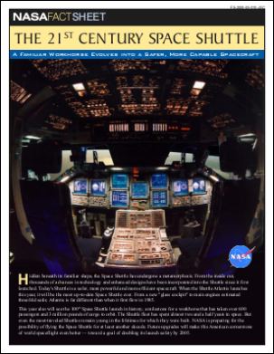
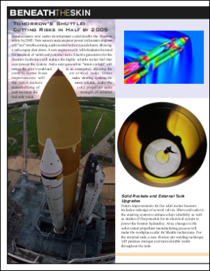
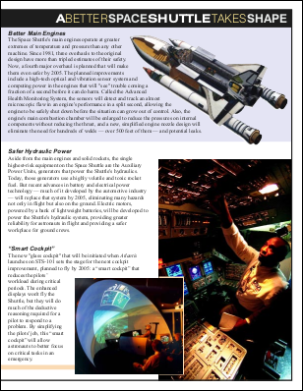
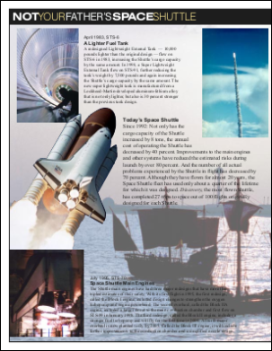

# PDF Rendering Example

This example shows how to render a PDF document.

For an example of how to render a PDF direct to screen and how to print a PDF see the ABCpdfView project and classes under the ABCpdf menu item.

## Read

We create an ABCpdf Doc object and read our source PDF.

```csharp
using Doc doc = new Doc();
doc.Read("../Rez/spaceshuttle.pdf");
```

## Prefs

We specify our base rendering settings.

```csharp
doc.Rendering.DotsPerInch = 36;
```

## Save

Finally we save the first four pages of the document in png format.

```csharp
for (int i = 1; i <= 4; i++) {
  doc.PageNumber = i;
  doc.Rect.String = doc.CropBox.String;
  doc.Rendering.Save("shuttle_p" + i.ToString() + ".png");
}
```

## Results

  
shuttle_p1.png

  
shuttle_p2.png

  
shuttle_p3.png

  
shuttle_p4.png
