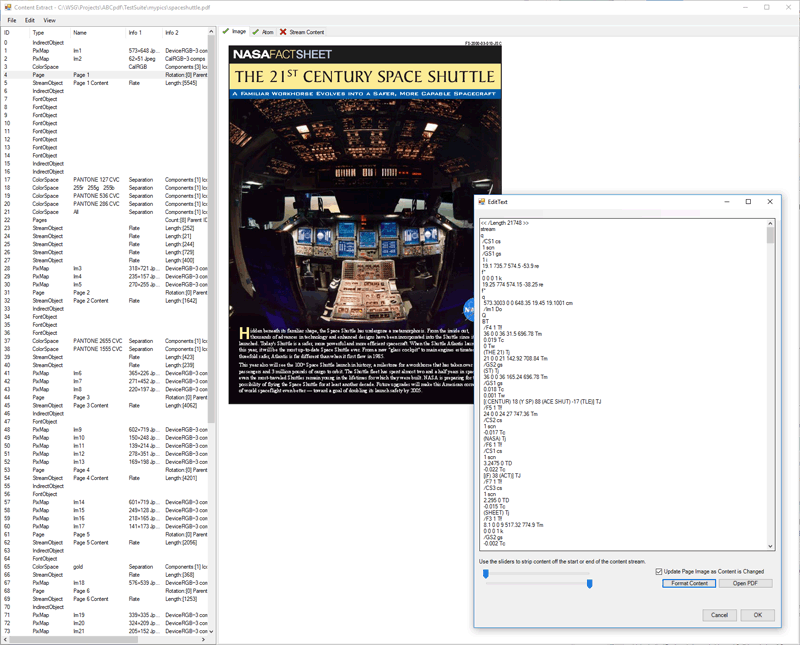

# PDFSurgeon Example Project

## Project

This is a wonderful tool which allows you to view and manipulate the content of PDF documents. So rather than an example project, this is more of a utility. You have the source so it is easy to adapt to your needs, however for most requirements it should be fine as-is.

This utility allows you to open a PDF and see the individual objects within it. It has a search function so you can search for all objects matching a particular structure or perhaps referencing another specific object. You can edit objects and then resave the document.

Indeed you can even decompress and edit a content stream for a particular page and see the changes to the rendered appearance in real time. As you type into the content stream, the rendered page changes.

For getting to know how PDF documents and content streams work, this is an invaluable tool.

The object list shows the ID, type and key details of each object. From the context menu you can decompress a stream, compress it using Flate or JPEG, re-encode it as ASCII85 or ASCIIHex, flatten Form XObjects or extract an object.

There are views for items such as bookmarks, fields, signatures, fonts, color spaces and annotations, and for any scripts and actions in a document. So it is also useful for working out why a PDF will not display properly or for finding embedded JavaScript.

  
Screenshot of PDFSurgeon
