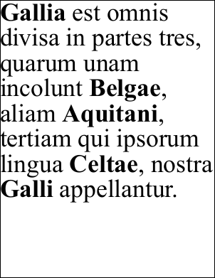

# AddTextStyled Function

Adds a block of multi-styled text to the current page.

## Syntax

[C#]

```csharp
int AddTextStyled(string text)int AddTextStyled(string dummy, int chainid)
```

## Params

| **Name** | **Description** |
| --- | --- |
| text | The HTML to be added to the page. |
| dummy | A dummy parameter. The contents are not used. |
| chainid | The Object ID of a previously added text block. |
| return | The Object ID of the newly added Text Object. |

## Notes

Adds a block of multi-styled text to the current page.

This function works in a similar manner to the [AddText](addtext.md) function but it allows you to add multi-styled text by inserting simple HTML tags. A listing of supported tags is given in the [Styled Text](3-concepts/b-htmlstyles.md) section of the documentation. Please see [Pos](2-properties/pos.md) for details on positioning when using vertical fonts.

You can chain together multiple text/HTML blocks so that text flows from one to the next. To do this you need to first add a block of text/HTML using [AddText](addtext.md) or AddTextStyled. Then add multiple new text/HTML blocks using Doc.AddTextStyled each time passing in the ID obtained from the previous call after adjusting the target location (such as the rectangle or the page).

When no more text is available the AddTextStyled function will return zero. Alternatively you can query the [TextLayer.Truncated](6-abcpdf.objects/textlayer/2-properties/truncated.md) property of the returned object before adding a new item to the chain.

This function returns the Object ID of the newly added Text Object. If no text could be added then zero is returned. This will happen if a zero length string was supplied or if the rectangle was too small for even one character to be displayed.

Typically you will get a return value of zero if your text was too large to fit in your [Rect](2-properties/rect.md) or if the [Pos](2-properties/pos.md) was at the end of the Rect.

Text styles for the entire HTML content are determined at the point at which the first item in a text chain is created. This means that varying document styles will not affect the way in which subsequent items in the chain are displayed.

For an example of chaining see the [Text Flow Example](4-examples/02-textflow.md).

Note that there is no requirement that blocks be organized in a linear chain. If you wish you can create trees of HTML blocks, flowing text from a chain head through multiple display areas on your document.

## Example

The following code adds some styled text to a document.

[C#]

```csharp
using var doc = new Doc();
doc.FontSize = 72;
doc.AddTextStyled("<b>Gallia</b> est omnis divisa in partes tres, quarum unam incolunt <b>Belgae</b>, aliam <b>Aquitani</b>, tertiam qui ipsorum lingua <b>Celtae</b>, nostra <b>Galli</b> appellantur.");
doc.Save("docaddhtml.pdf");
```


docaddhtml.pdf

Also see example code in:

* [ABCpdf Tagged Text Example](4-examples/02-texttagged.md)
* [ABCpdf Multistyle Example](4-examples/03-multistyled.md)
* [XTextStyle AutoTag Property](xtextstyle/2-properties/autotag.md)
* [XTextStyle Kerning Property](xtextstyle/2-properties/kerning.md)
* [CustomFont Embed Function](8-abcpdf.operations/R-customfont/1-methods/02-embed.md).
