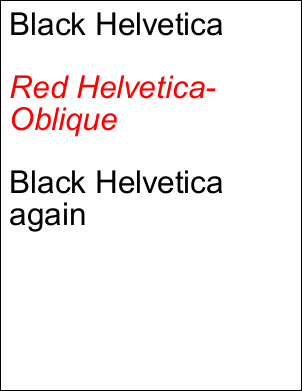

# String Property

| Type | Default Value | Read Only | Description |
| --- | --- | --- | --- |
| `string` | Variable | No | A string representation of the graphic style of the document |

## Notes

A string representation of the graphic style of the document.

This covers the [Transform](transform.md), [ColorSpace](colorspace.md), [Color](color.md), [Font](font.md), [TextStyle](textstyle.md), [Width](width.md) and [Options](options.md) properties. However it does not cover the [Page](page.md), [Layer](layer.md), [Rect](rect.md) or [Pos](pos.md) properties.

## Example

In this example we show how to use the String property to implement a graphics state stack with Push and Pop operators.

```csharp
using var doc = new Doc();
doc.FontSize = 64;
doc.Rect.Inset(20, 20);
doc.Font = doc.AddFont("Helvetica");
var state = new Stack<string>();
state.Push(doc.String);
doc.AddText("Black Helvetica\r\n\r\n");
doc.Color.SetRgb(255, 0, 0);
doc.Font = doc.AddFont("Helvetica-Oblique");
doc.AddText("Red Helvetica-Oblique\r\n\r\n");
doc.String = state.Pop();
doc.AddText("Black Helvetica again\r\n\r\n");
doc.Save("savestate.pdf");
```

  
savestate.pdf
