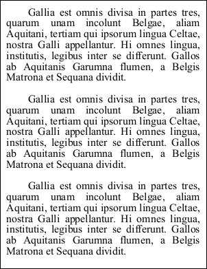

# TextStyle Property

| Type | Default | Read Only | Description |
| --- | --- | --- | --- |
| [`XTextStyle`](../../xtextstyle/index.md) | Ten point text. | Yes | The current style for drawing text. |

## Notes

This property determines the current style settings used for adding text.

This property is read only, but the object it returns can be modified.

## Example

The following code creates a PDF document and adds some text using a number of the text style properties to control formatting.

```csharp
using var doc = new Doc();
string text = "Gallia est omnis divisa in partes tres, quarum unam incolunt Belgae, aliam Aquitani, tertiam qui ipsorum lingua Celtae, nostra Galli appellantur. Hi omnes lingua, institutis, legibus inter se differunt. Gallos ab Aquitanis Garumna flumen, a Belgis Matrona et Sequana dividit.";
text = text + "\r\n" + text + "\r\n" + text + "\r\n";
doc.Rect.Inset(20, 20);
doc.TextStyle.Size = 32;
doc.TextStyle.Justification = 1;
doc.TextStyle.Indent = 64;
doc.TextStyle.ParaSpacing = 32;
doc.AddText(text);
doc.Save("doctextstyle.pdf");
```

  
doctextstyle.pdf

Also see example code in: [ABCpdf Text Flow Example](../../../4-examples/02-textflow.md), [ABCpdf Text Flow Round Image Example](../../../4-examples/02-textflow2.md), [ABCpdf Tagged Text Example](../../../4-examples/02-texttagged.md), [ABCpdf Deletion Example](../../../4-examples/05-deletion.md), [ABCpdf Headers and Footers Example](../../../4-examples/06-headers.md), [Doc AddPage Function](../1-methods/addpage.md), [Doc Append Function](../1-methods/append.md), [Doc Read Function](../1-methods/read.md), [Doc RemapPages Method](../1-methods/remappages.md), [XRendering SaveAlpha Property](../../xrendering/2-properties/savealpha.md), [XTagging Open Function](../../xtagging/1-methods/04-open.md), [XTagging Close Function](../../xtagging/1-methods/05-close.md), [XTextStyle AutoTag Property](../../xtextstyle/2-properties/autotag.md), [XTextStyle Bold Property](../../xtextstyle/2-properties/bold.md), [XTextStyle CharSpacing Property](../../xtextstyle/2-properties/charspacing.md), [XTextStyle HPos Property](../../xtextstyle/2-properties/hpos.md), [XTextStyle Indent Property](../../xtextstyle/2-properties/indent.md), [XTextStyle Italic Property](../../xtextstyle/2-properties/italic.md), [XTextStyle Justification Property](../../xtextstyle/2-properties/justification.md), [XTextStyle Kerning Property](../../xtextstyle/2-properties/kerning.md), [XTextStyle LeftMargin Property](../../xtextstyle/2-properties/leftmargin.md), [XTextStyle LineSpacing Property](../../xtextstyle/2-properties/linespacing.md), [XTextStyle Outline Property](../../xtextstyle/2-properties/outline.md), [XTextStyle ParaSpacing Property](../../xtextstyle/2-properties/paraspacing.md), [XTextStyle Size Property](../../xtextstyle/2-properties/size.md), [XTextStyle Strike Property](../../xtextstyle/2-properties/strike.md), [XTextStyle Strike2 Property](../../xtextstyle/2-properties/strike2.md), [XTextStyle Underline Property](../../xtextstyle/2-properties/underline.md), [XTextStyle VPos Property](../../xtextstyle/2-properties/vpos.md), [XTextStyle WordSpacing Property](../../xtextstyle/2-properties/wordspacing.md), [XTransform Rotate Function](../../xtransform/1-methods/rotate.md), [XTransform AngleUnit Property](../../xtransform/2-properties/angleunit.md), [FontObject RuneWidths Property](../../../6-abcpdf.objects/fontobject/2-properties/runewidths.md), [FontObject Widths Property](../../../6-abcpdf.objects/fontobject/2-properties/widths.md), [Page GetBitmap Function](../../../6-abcpdf.objects/page/1-methods/getbitmap.md), [XpsImportOperation Import Function](../../../8-abcpdf.operations/4-xpsimportoperation/1-methods/import.md), [SwfImportOperation Import Function](../../../8-abcpdf.operations/5-swfimportoperation/1-methods/import.md).
