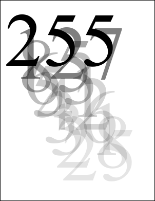

# Alpha Property

| Type | Default | Read Only | Description |
| --- | --- | --- | --- |
| `int` | 255 | No | The alpha opacity. |

## Notes

Allows you to get or set the alpha opacity of the color.

Alpha values can range from 0 to 255. Zero indicates fully transparent and 255 indicates fully opaque.

## Example

Here we create a PDF document showing how different values of alpha result in different levels of transparency.

```csharp
using var doc = new Doc();
doc.Rect.Inset(20, 20);
doc.FontSize = 300;
for (int i = 1; i <= 10; i++) {
  doc.Color.Alpha = 255 / i;
  doc.AddText(doc.Color.Alpha.ToString());
  doc.Rect.Move(25, -50);
}
doc.Save("coloralpha.pdf");
```

  
coloralpha.pdf

Also see example code in: [SwfImportOperation Import Function](../../../8-abcpdf.operations/5-swfimportoperation/1-methods/import.md).
