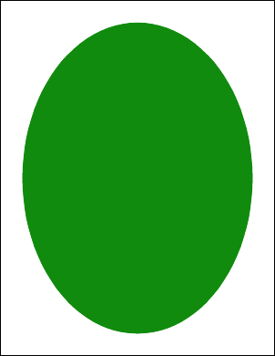

# Components Property

| Type | Default Value | Read Only | Description |
| --- | --- | --- | --- |
| `IList<double>` | n/a | Yes | The components of the color in native PDF format |

## Notes

The components of the color in native PDF format.

PDF color components typically range between zero - no intensity - and one - 100% intensity. However this is not always the case. For color spaces such as Lab the components may take a wider range of values.

## Example

In the following example we demonstrate how to use generic color components to draw in the Lab color space.

```csharp
using var doc = new Doc();
doc.Width = 80;
doc.Rect.Inset(50, 50);
var cs = new ColorSpace(doc.ObjectSoup, ColorSpaceType.Lab);
doc.ColorSpace = cs.ID;
// This Lab color is a deep green
doc.Color.ColorSpace = ColorOperatorType.ColorSpace;
doc.Color.Components[0] = 50; // L range is 0 to +100
doc.Color.Components[1] = -50; // a range is -100 to +100
doc.Color.Components[2] = +50; // B range is -100 to +100
doc.AddOval(true);
doc.Save("examplelabcolorspace.pdf");
```

  
examplelabcolorspace.pdf
