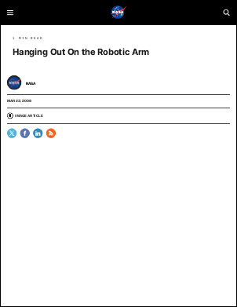

# ImageQuality Property

| **Type** | **Default** | **Read Only** | **Description** |
| --- | --- | --- | --- |
|  | 101 | No | The quality of compression acceptable for continuous tone images such as JPEGs. |

## Notes

This property applies to the [ABCGecko](2-forgecko.md) and [MSHTML](2-formshtml.md) engines.

This property determines the image quality acceptable when rendering HTML.

ABCpdf uses a high quality lossless compression method for image compression when rendering HTML.

Using this setting you can indicate the quality of compression which is acceptable for continuous tone images such as JPEGs.

This can result in a considerable reduction in file size with little or no loss in output quality.

Note that the MSHTML engine contains optimizations to allow data to be passed directly from the web through to the PDF without recompression. However it can only do this if you do not indicate that you need this data recompressed. As such you may find it more effective in terms of output size and output quality, to leave the default setting in place.

Qualities should range between 0 and 100 (75 is a reasonable value). Values higher than 100 will result in lossless compression being used in all situations.

## Example

The following example shows the effect that this parameter has on PDF rendering.

[C#]

```csharp
using var doc = new Doc();
string uri = "http://www.nasa.gov/multimedia/imagegallery/image_feature_313.html";
// Set low image quality for HTML rendering
doc.HtmlOptions.ImageQuality = 5;
doc.AddImageUrl(uri);
// Save the document
doc.Save("HtmlOptionsImageQuality5.pdf");
doc.Clear();
// Set lossless image quality for HTML rendering
doc.HtmlOptions.ImageQuality = 101;
doc.AddImageUrl(uri);
// Save the document
doc.Save("HtmlOptionsImageQuality101.pdf");
```


HtmlOptionsImageQuality5.pdf [file size 42 KB]

