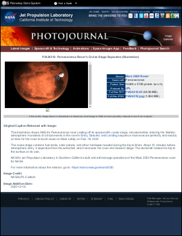

# RetryCount Property

| Type | Default Value | Read Only | Description |
| --- | --- | --- | --- |
| `int` | 5 | No | The number of times a page should be retried if unavailable or invalid. |

## Notes

This property applies to all the HTML engines: [ABCChrome](2-forchrome.md), [ABCGecko](2-forgecko.md), [ABCWebKit](2-forwebkit.md) and [MSHTML](2-formshtml.md).

This property controls how many times ABCpdf will attempt to obtain a page.

HTML rendering may fail one time but succeed the next. This is often for reasons outside the control of ABCpdf.

So ABCpdf may attempt to re-request a page if it is not immediately available. This is analogous to clicking on the refresh button of a web browser if the page is failing to load.

See the [ContentCount](contentcount.md) and the [Timeout](timeout.md) properties for how ABCpdf determines if a page is unavailable or invalid.

## Example

The following example shows the effect that this parameter has on HTML rendering.

```csharp
using var doc = new Doc();
string uri = "https://photojournal.jpl.nasa.gov/catalog/PIA24312";
// Set minimum number of items a page of HTML should contain.
// Otherwise the page will be assumed to be invalid.
doc.HtmlOptions.ContentCount = 20;
// Try to obtain html page up to 11 times
doc.HtmlOptions.RetryCount = 10;
// The page must be obtained in less then 10 seconds
doc.HtmlOptions.Timeout = 10000;
try {
  doc.AddImageUrl(uri);
}
catch {
  // Page couldn't be loaded
}
// Save the document
doc.Save("HtmlOptionsRetryCount.pdf");
```

  
HtmlOptionsRetryCount.pdf

Also see example code in: [WebPageOperation Doc Property](../../../8-abcpdf.operations/q-webpageoperation/2-properties/01-doc.md).
