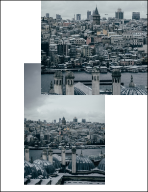

# Selection Property

| Type | Default | Read Only | Description |
| --- | --- | --- | --- |
| [`XRect`](../../xrect/index.md) | The dimensions of the current frame. | Yes | The current selection rectangle. |

## Notes

You may wish to add only a portion of an image. By changing the selection rectangle you can specify different areas to be added.

Note that this property only has an effect on an Image if the [Indirect](indirect.md) property is true (which is generally the case).

This property is read only, but the rectangle it returns can be modified.

## Example

Here we open a TIFF file using the XImage object. We add the entire image to the document and then just a portion of the image using the Selection property.

```csharp
using var img = new XImage();
using var doc = new Doc();
img.SetFile("../mypics/mypic.jpg");
doc.Rect.String = img.Selection.String;
doc.Rect.Magnify(0.5, 0.5);
doc.Rect.Position(100, 30);
doc.AddImageObject(img, false);
img.Selection.Inset(100, 200);
doc.Rect.String = img.Selection.String;
doc.Rect.Position(170, 400);
doc.AddImageObject(img, false);
doc.Save("imageselect.pdf");
```

  
imageselect.pdf
