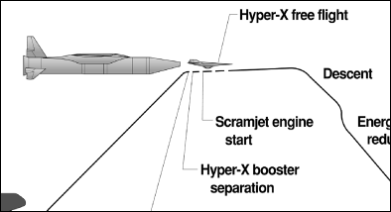
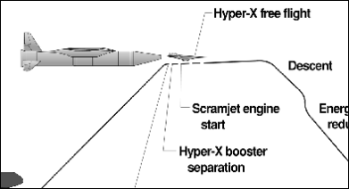

# AntiAliasImages Property

| Type | Default Value | Read Only | Description |
| --- | --- | --- | --- |
| `bool` | true | No | Whether to anti-alias images. |

## Notes

Determines whether image transformations will be interpolated.

This feature is most useful when the original embedded image resolution is greater than the output resolution. When this property is set to true interpolation is used to scale images thus increasing output quality.

Whether the edges of images are anti-aliased is determined by the [AntiAliasPolygons](antialiaspolygons.md) property.

## Example

The following example shows the effect that this parameter has on PDF rendering.

```csharp
using var doc = new Doc();
doc.Read("../mypics/HyperX.pdf");
doc.Rect.Inset(200, 200);
// Render document with AntiAliasImages = true (default)
doc.Rendering.Save("RenderingAntiAliasImagesTrue.png");
// Render document with AntiAliasImages = false
doc.Rendering.AntiAliasImages = false;
// Save the image
doc.Rendering.Save("RenderingAntiAliasImagesFalse.png");
```

  
RenderingAntiAliasImagesTrue.png

  
RenderingAntiAliasImagesFalse.png
