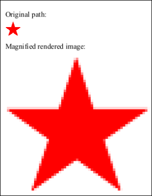
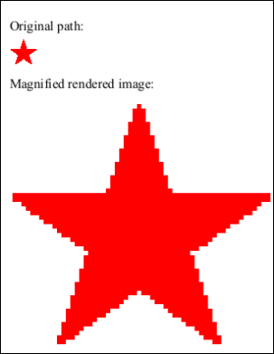

# AntiAliasPolygons Property

| Type | Default Value | Read Only | Description |
| --- | --- | --- | --- |
| `bool` | true | No | Whether to anti-alias polygons. |

## Notes

Determines whether polygons will be rendered with anti-aliased edges.

Anti-aliasing is a technique for using gradients of color to eliminate jagged edges when objects are drawn. The object edges are blurred to reduce pixelation.

## Example

The following example shows the effect that this parameter has on PDF rendering.

```csharp
using var doc = new Doc();
// Add a polygon
doc.Color.String = "255 0 0";
doc.AddPoly("32 650 50 704 68 650 22 683 79 683 32 650", true);
doc.Rect.String = "20 650 80 704";
// Render the drawn area with AntiAliasPolygons (default)
using var antiAliasedBitmap = doc.Rendering.GetBitmap();
// Render the drawn area without AntiAliasPolygons
doc.Rendering.AntiAliasPolygons = false;
using var aliasedBitmap = doc.Rendering.GetBitmap();
// Add magnified aliased image
doc.Rect.String = "5 20 605 560";
doc.AddImageBitmap(aliasedBitmap, false);
// Anotate
doc.Color.String = "black";
doc.FontSize = 30;
doc.Pos.String = "20 750";
doc.AddText("Original path:");
doc.Pos.String = "20 620";
doc.AddText("Magnified rendered image:");
// Render the document with aliased image
doc.Rendering.DotsPerInch = 36;
doc.Rect.String = doc.MediaBox.String;
doc.Rendering.Save("RenderingAntiAliasPolygonsFalse.png");
// Add magnified antialiased image
doc.Rect.String = "5 20 605 560";
doc.AddImageBitmap(antiAliasedBitmap, false);
// Render the document with antialiased image
doc.Rendering.DotsPerInch = 36;
doc.Rect.String = doc.MediaBox.String;
doc.Rendering.Save("RenderingAntiAliasPolygonsTrue.png");
```

  
RenderingAntiAliasPolygonsTrue.png

  
RenderingAntiAliasPolygonsFalse.png
