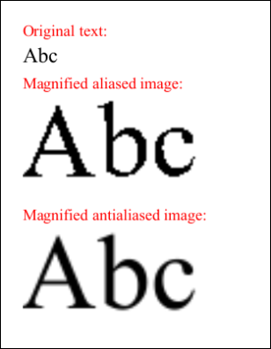

# AntiAliasText Property

| Type | Default Value | Read Only | Description |
| --- | --- | --- | --- |
| `bool` | true | No | Whether to anti-alias text. |

## Notes

Determines whether text will be rendered with anti-aliased edges.

Anti-aliasing is a technique for using gradients of color to eliminate jagged edges when objects are drawn. The object edges are blurred to reduce pixelation.

## Example

The following example shows the effect that this parameter has on PDF rendering.

```csharp
using var doc = new Doc();
doc.Rect.Inset(50, 50);
// Add some text
doc.FontSize = 48;
doc.Pos.String = "50 690";
int id = doc.AddText("Abc");
// Render images
doc.Rect.String = doc.GetInfo(id, "rect");
doc.Rendering.AntiAliasText = true;
using var antialiasedBitmap = doc.Rendering.GetBitmap();
doc.Rendering.AntiAliasText = false;
using var aliasedBitmap = doc.Rendering.GetBitmap();
// Add enlarged images to the pdf file
doc.Rect.Magnify(5, 5);
doc.Rect.Move(0, -300);
doc.AddImageBitmap(aliasedBitmap, false);
doc.Rect.Move(0, -300);
doc.AddImageBitmap(antialiasedBitmap, false);
// Annotate
doc.Rect.String = doc.MediaBox.String;
doc.Color.String = "255 0 0";
doc.FontSize = 36;
doc.Pos.String = "50 740";
doc.AddText("Original text:");
doc.Pos.String = "50 620";
doc.AddText("Magnified aliased image:");
doc.Pos.String = "50 320";
doc.AddText("Magnified antialiased image:");
// Save render of pdf files
doc.Rendering.AntiAliasText = true;
doc.Rendering.DotsPerInch = 36;
doc.Rendering.Save("RenderingAntiAliasText.png");
```

  
RenderingAntiAliasText.png
