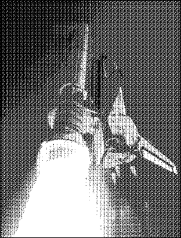

# DefaultHalftone Property

| Type | Default Value | Read Only | Description |
| --- | --- | --- | --- |
| `string` | "Spot, 30, 100, CosineDot" | No | Halftone type and options. |

## Notes

Specifies the default halftone type and options.

The default halftone remains in effect until an embedded halftone screen is encountered.

The Type can be:

- Spot
- ErrorDiffusion
- OrderedDither
- Threshold

If the type is Spot then an angle in degrees, frequency and spot function can also be specified. These should be separated by commas with no extraneous spaces. The spot functions available are:

- SimpleDot
- InvertedSimpleDot
- DoubleDot
- InvertedDoubleDot
- CosineDot
- Double
- InvertedDouble
- Line
- LineX
- LineY
- Round
- Ellipse
- EllipseA
- InvertedEllipseA
- EllipseB
- EllipseC
- InvertedEllipseC
- Square
- Cross
- Rhomboid
- Diamond

If the type is Threshold you need to specify a value - for example "'Threshold=60". This is used when calculating the value of a black and white pixel. If the grey level l is greater than the threshold the pixel will be black otherwise it will be white. This value is a percentage luminance value so it should range between 0 and 100.

For full details of how Halftones work you should see the Adobe PDF Specification available from the Adobe web site.

## Example

The following example shows the effect that this parameter has on PDF rendering.

```csharp
using var doc = new Doc();
using var image = new XImage();
image.SetFile("../mypics/Shuttle.jpg");
doc.Rect.String = image.Selection.String;
doc.AddImage(image);
// Save rendered image as black and white picture using Line spot function
doc.Rendering.UseEmbeddedHalftone = false;
doc.Rendering.DotsPerInch = 50;
doc.Rendering.ColorSpace = XRendering.ColorSpaceType.Gray;
doc.Rendering.BitsPerChannel = 1;
doc.Rendering.DefaultHalftone = "Spot,30,100,Line";
doc.Rendering.Save("RenderingHalftoneLine.png");
// Save rendered image as black and white picture using Diamond spot function
doc.Rendering.DefaultHalftone = "Spot,0,100,Diamond";
doc.Rendering.Save("RenderingHalftoneDiamond.png");
```

  
RenderingHalftoneLine.png

  
RenderingHalftoneDiamond.png
