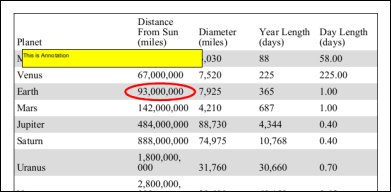

# DrawAnnotations Property

| Type | Default Value | Read Only | Description |
| --- | --- | --- | --- |
| `bool` | true | No | Whether to render fields and annotations. |

## Notes

Determines whether fields and annotations will be rendered.

PDF fields and annotations are not part of the PDF content. Instead they float over the PDF background. You may choose to render these fields or you may wish to avoid rendering them.

The export of file types like XPS, DOCX and HTML is implemented using rendering. For this reason the DrawAnnotations property will determine if Annotations are exported when saving these formats using the [Doc.Save](../../doc/1-methods/save.md) method.

## Example

The following example shows the effect that this parameter has on PDF rendering.

```csharp
using var doc = new Doc();
doc.Read("../mypics/Annotations.pdf");
doc.Rect.Pin = XRect.Corner.TopLeft;
doc.Rect.Height = 300;
// Render document with DrawAnnotations (default)
doc.Rendering.Save("RenderingDrawAnnotationsTrue.png");
// Render document without DrawAnnotations
doc.Rendering.DrawAnnotations = false;
doc.Rendering.Save("RenderingDrawAnnotationsFalse.png");
```

  
RenderingDrawAnnotationsTrue.png

  
RenderingDrawAnnotationsFalse.png
