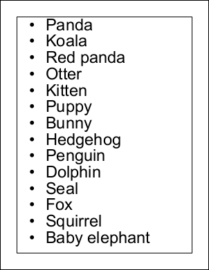

# Open Function

Opens a sequence of tags.

## Syntax

[C#]

```csharp
<a href="../default.htm">Tag</a> Open(<a href="../default.htm">Tag</a> tag)<a href="../default.htm">Tag</a> Open(params string[] types)
```

## Params

| **Name** | **Description** |
| --- | --- |
| tag | The tag to be opened. |
| types | The types of tags to be opened in sequence |
| return | The last tag opened. |

## Notes

Opens a sequence of tags.

Ensure the Doc.Page is set correctly when you open a tag. If you open a tag on a page and then move to another you will end up with a tag that includes the page even though there may not be any tagged content on it.

## Example

The following code adds a list of animals. Normally this list would go directly into the Document root level tag. However here we first open a Section, Div and P (paragraph) so that the list will go inside those elements instead.

[C#]

```csharp
using var doc = new Doc();
doc.Font = doc.EmbedFont("Arial");
doc.TextStyle.Size = 48;
doc.Rect.Inset(50, 50);
string[] animals = ["Panda", "Koala", "Red panda", "Otter", "Kitten",
  "Puppy", "Bunny", "Hedgehog", "Penguin", "Dolphin", "Seal", "Fox",
  "Squirrel", "Baby elephant", "Fawn", "Chick", "Hamster",
  "Guinea pig", "Ferret", "Quokka"];
var sb = new StringBuilder();
sb.AppendLine("<ul>");
foreach (var animal in animals)
  sb.AppendLine($"<li>{animal}</li>");
sb.AppendLine("</ul>");
doc.TextStyle.AutoTag = true;
doc.Tag.Open("Sect", "Div", "P");
int id = doc.AddTextStyled(sb.ToString());
doc.FrameRect();
while (true) {
  var tl = (TextLayer)doc.ObjectSoup[id];
  if (!tl.Truncated)
    break;
  doc.Page = doc.AddPage();
  id = doc.AddTextStyled("", id);
  doc.FrameRect();
}
doc.Tag.Close("P", "Div", "Sect");
doc.Save("doctagopen.pdf");
doc.Read("doctagopen.pdf");
var ts = doc.Tag.GetStructure();
var str = ts.ExtractStructure();
File.WriteAllText("out.txt", str.ToString());
```


doctagopen.pdf [Page 1]

