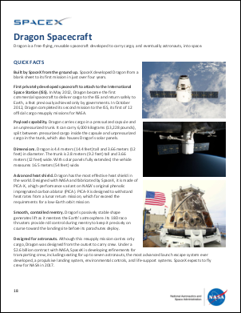

# AddFocus Function

Assign a tag to a particular area of the current page.

## Syntax

*C#*

[`Focus`](../../xtagging.focus/index.md)` AddFocus(`[`StructureElementElement`](../../../9-abcpdf.elements/14-document/1566-structureelementelement/index.md)` element, `[`XRect`](../../xrect/index.md)` area)`

## Params

| Name | Description |
| :---: | --- |
| element | The structure element to which the area should be assigned. |
| area | The area to take the tag. |
| returns | The focus. |

## Notes

Assign a tag to a particular area of the current page.

Tagging is generally performed most easily by using the [Open](04-open.md) and [Close](05-close.md) methods as content is added.

However for some purposes it can be simpler to assign tags to areas on a page. This is particularly the case when you are analyzing an existing document rather than adding content yourself.

This method allows you to specify areas of the document to which a particular tag should be applied. You can overlap areas and the page content will be broken up to fit the overlapped shapes. Text on a page will be tagged using the most recent area which intersects with that text.

## Example

The following code adds sequence of tagged areas to a page. We first delete any existing structure so we have a clean slate. The first Artifact covers the entire page so that anything which is not tagged later will become an artifact. The next tags create a nested sequence of H1, H2 and P elements.

```csharp
using var doc = new Doc();
doc.Read("../Rez/spacex_nasa_dragon.pdf");
Atom.RemoveItem(doc.ObjectSoup.Catalog.Atom, "StructTreeRoot");
var st = doc.Tag.GetStructure();
st.Detag();
st.Title = "SpaceX NASA Dragon";
st.CreateAsRequired();
var div = st.Root.AddKid("Document").AddKid("Div");
var artifact = new StructureElementElement(div) { EntryS = "Artifact" };
doc.Tag.AddFocus(artifact, doc.Rect).AddMcids = false;
var h1 = doc.Tag.AddFocus(div.AddKid("H1"), XRect.FromSides(0, 650, 600, 710)).Tag;
var h2 = doc.Tag.AddFocus(div.AddKid("H2"), XRect.FromSides(0, 620, 600, 650)).Tag;
doc.Tag.AddFocus(h2.AddKid("P"), XRect.FromSides(0, 580, 600, 620));
doc.Tag.AddFocus(h2.AddKid("P"), XRect.FromSides(0, 500, 600, 580));
doc.Tag.AddFocus(h2.AddKid("P"), XRect.FromSides(0, 440, 600, 500));
doc.Tag.AddFocus(h2.AddKid("P"), XRect.FromSides(0, 360, 600, 440));
doc.Tag.AddFocus(h2.AddKid("P"), XRect.FromSides(0, 270, 600, 360));
doc.Tag.AddFocus(h2.AddKid("P"), XRect.FromSides(0, 200, 600, 270));
doc.Tag.AddFocus(h2.AddKid("P"), XRect.FromSides(0, 100, 600, 200));
var focus = doc.Tag.AddFocus(div.AddKid("Figure"), XRect.FromSides(360, 480, 600, 650));
focus.Tag.EntryAlt = "Spacecraft in orbit over earth.";
// in later versions, instead of the next five lines, you can just use ...
var layout = new StandardLayoutAttributesElement(focus.Tag);
layout.EntryO = "Layout";
layout.EntryBBox = new RectangleElement(ArrayAtom.FromXRect(focus.Bounds), focus.Tag.Host);
focus.Tag.EntryA = new ArrayElement<Element>(focus.Tag);
focus.Tag.EntryA.Add(layout);
// ... focus.Tag.SetBBox(focus.Bounds);
doc.Tag.MakePdfUAConformant = true;
doc.Save("taggedarea.pdf");
st.UpdateActualText(true, true);
var txt = st.ExtractStructure();
File.WriteAllText("taggedarea.txt", txt.ToString());
```

  
taggedarea.pdf

The output tag structure from the ExtractStructure call will be something like this,

```
<Root ObjID="1">
       <Document ObjID="3">
                <Div ObjID="4">
                     <Artifact PageNumber="1" ObjID="5">
                               <ActualText>     18    </ActualText>
                            <MCID ID="0" />
                             <MCID ID="1" />
                             <MCID ID="24" />
                            <MCID ID="25" />
                    </Artifact>
                   <H1 PageNumber="1" ObjID="6">
                             <ActualText>Dragon Spacecraft Dragon is a free-flying, reusable spacecraft developed to carry cargo, and eventually astronauts, into space.   </ActualText>
                             <MCID ID="2" />
                             <MCID ID="3" />
                             <MCID ID="4" />
                     </H1>
                 <H2 PageNumber="1" ObjID="7">
                             <ActualText> QUICK FACTS   </ActualText>
                                <MCID ID="5" />
                             <MCID ID="6" />
                             <MCID ID="7" />
                             <P PageNumber="1" ObjID="8">
                                      <ActualText>Built by SpaceX from the ground up. SpaceX developed Dragon from a blank sheet to its first mission in just over four years.  </ActualText>
                                 <MCID ID="8" />
                                     <MCID ID="9" />
                             </P>
                          <P PageNumber="1" ObjID="9">
                                      <ActualText>First privately developed spacecraft to attach to the International Space Station (ISS). In May 2012, Dragon became the first commercial spacecraft to deliver cargo to the ISS and return safely to Earth, a feat previously achieved only by governments. In October 2012, Dragon completed its second mission to the ISS, its first of 12 official cargo resupply missions for NASA. </ActualText>
                                       <MCID ID="10" />
                            </P>
                          <P PageNumber="1" ObjID="10">
                                     <ActualText> Payload capability. Dragon carries cargo in a pressurized capsule and an unpressurized trunk. It can carry 6,000 kilograms (13,228 pounds), split between pressurized cargo inside the capsule and unpressurized cargo in the trunk, which also houses Dragon’s solar panels.  </ActualText>
                                 <MCID ID="11" />
                                    <MCID ID="12" />
                            </P>
                          <P PageNumber="1" ObjID="11">
                                     <ActualText> Dimensions. Dragon is 4.4 meters (14.4 feet) tall and 3.66 meters (12 feet) in diameter. The trunk is 2.8 meters (9.2 feet) tall and 3.66 meters (12 feet) wide. With solar panels fully extended, the vehicle measures 16.5 meters (54 feet) wide.  </ActualText>
                                 <MCID ID="13" />
                                    <MCID ID="14" />
                                    <MCID ID="15" />
                            </P>
                          <P PageNumber="1" ObjID="12">
                                     <ActualText>Advanced heat shield. Dragon has the most effective heat shield in the world. Designed with NASA and fabricated by SpaceX, it is made of PICA-X, a high-performance variant on NASA’s original phenolic impregnated carbon ablator (PICA). PICA-X is designed to withstand heat rates from a lunar return mission, which far exceed the requirements for a low-Earth orbit mission. </ActualText>
                                     <MCID ID="16" />
                            </P>
                          <P PageNumber="1" ObjID="13">
                                     <ActualText> Smooth, controlled reentry. Dragon’s passively stable shape generates lift as it reenters the Earth’s atmosphere. Its 18 Draco thrusters provide roll control during reentry to keep it precisely on course toward the landing site before its parachutes deploy.   </ActualText>
                                      <MCID ID="17" />
                                    <MCID ID="18" />
                                    <MCID ID="19" />
                            </P>
                          <P PageNumber="1" ObjID="14">
                                     <ActualText>Designed for astronauts. Although this resupply mission carries only cargo, Dragon was designed from the outset to carry crew. Under a $2.6 billion contract with NASA, SpaceX is developing refinements for transporting crew, including seating for up to seven astronauts, the most advanced launch escape system ever developed, a propulsive landing system, environmental controls, and life-support systems. SpaceX expects to fly crew for NASA in 2017.  </ActualText>
                                     <MCID ID="20" />
                                    <MCID ID="21" />
                            </P>
                  </H2>
         </Div>
        </Document>
</Root>
```
