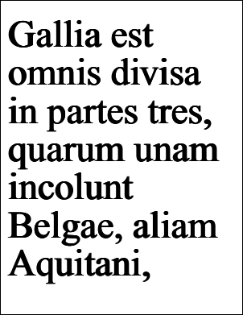

# Bold Property

| Type | Default | Read Only | Description |
| --- | --- | --- | --- |
| `bool` | false | No | Whether to apply a synthetic bold effect. |

## Notes

This property determines whether a synthetic bold effect is applied to text.

It is generally better to specify a bold typeface rather than synthesize a bold effect using the current typeface. However under some circumstances this may not be possible and you may prefer to apply a synthetic bold effect.

## Example

In this example we add some bold text to a document.

```csharp
using var doc = new Doc();
string text = "Gallia est omnis divisa in partes tres, quarum unam incolunt Belgae, aliam Aquitani, tertiam qui ipsorum lingua Celtae, nostra Galli appellantur.";
doc.Rect.Inset(20, 40);
doc.TextStyle.Size = 96;
doc.TextStyle.Bold = true;
doc.AddText(text);
doc.Save("stylebold.pdf");
```

  
stylebold.pdf

Also see example code in: [XTagging Close Function](../../xtagging/1-methods/05-close.md).
