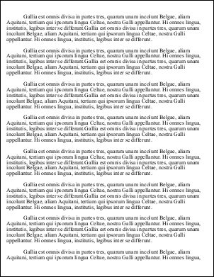

# Indent Property

| Type | Default | Read Only | Description |
| --- | --- | --- | --- |
| `double` | 0 | No | The first line of paragraph indent. |

## Notes

This property determines the horizontal indent applied to the first line of every paragraph.

If the indent is positive the start of the first line is shifted to the right by the specified number of points. If the indent is negative it is shifted to the left by the specified number of units.

## Example

In this example we add a block of text to a document. We specify a [ParaSpacing](paraspacing.md) value to space out the paragraphs and an Indent value to indent the first line of each paragraph.

```csharp
using var doc = new Doc();
string text = "Gallia est omnis divisa in partes tres, quarum unam incolunt Belgae, aliam Aquitani, tertiam qui ipsorum lingua Celtae, nostra Galli appellantur. Hi omnes lingua, institutis, legibus inter se differunt.";
text = text + text;
text = text + "\r\n" + text + "\r\n";
text = text + text + text + text;
doc.Rect.Inset(20, 40);
doc.TextStyle.Size = 16;
doc.TextStyle.ParaSpacing = 16;
doc.TextStyle.Indent = 48;
doc.AddText(text);
doc.Save("styleindent.pdf");
```

  
styleindent.pdf

Also see example code in: [Doc TextStyle Property](../../doc/2-properties/textstyle.md), [XTransform Rotate Function](../../xtransform/1-methods/rotate.md).
