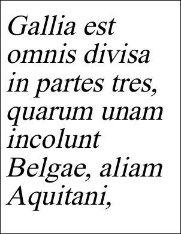

# Italic Property

| Type | Default | Read Only | Description |
| --- | --- | --- | --- |
| `bool` | false | No | Whether to apply a synthetic italic effect. |

## Notes

This property determines whether a synthetic italic effect is applied to text.

It is generally better to specify an italic typeface rather than synthesize an italic effect using the current typeface. However, under some circumstances this may not be possible and you may prefer to apply a synthetic italic effect.

## Example

In this example we add some italic text to a document.

```csharp
using var doc = new Doc();
string text;
text = "Gallia est omnis divisa in partes tres, quarum unam incolunt Belgae, aliam Aquitani, tertiam qui ipsorum lingua Celtae, nostra Galli appellantur.";
doc.Rect.Inset(20, 40);
doc.TextStyle.Size = 96;
doc.TextStyle.Italic = true;
doc.AddText(text);
doc.Save("styleitalic.pdf");
```

  
styleitalic.pdf
