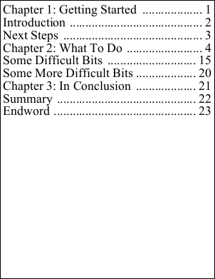

# Kerning Property

| Type | Default Value | Read Only | Description |
| --- | --- | --- | --- |
| `KerningType` | KerningType.Default | No | The kerning method. |

## Notes

The kerning method.

Kerning is similar to [character spacing](charspacing.md) in that it controls how far apart two characters are. However rather than being a constant, it is a value which is determined by the two characters themselves. So the kerning for "tt" would likely be different than for "te".

The KerningType enumeration may take the following values:

- None - No kerning.
- Default - Applies kerning. GPOS tables are not used where white space characters are involved.
- DefaultWithWhiteSpace - Applies kerning. White space characters are treated equally to other characters.

The default kerning method is based around the kerning tables in the TrueType font file. Not all fonts contain kerning tables so not all fonts will kern.

There are two font tables which may be used for kerning - the kern tables and the GPOS tables. The kern tables are an older and simpler standard while the GPOS tables are a more recent and complex standard. Many fonts will contain both - the kern table for backwards compatibility and the GPOS table for more sophisticated layout.

When the text [Direction](direction.md) is left at Default and kerning is on, only TrueType kern tables are used for kerning - the GPOS tables are not used.

If all the following conditions are met then the text shaping engine is engaged and the OpenType GPOS table is preferred over the kern table.

- The [Direction](direction.md) is set to LeftToRight or RightToLeft.
- The font is embedded using the Unicode language.
- The [Shaping](shaping.md) property indicates that shaping should occur.

When text shaping is used kern tables (if available) are used for applying kerning to combinations involving white space characters. If you prefer the GPOS tables for this type of combination you should specify the DefaultWithWhiteSpace.

So for backwards compatibility with older layout code you will want to use the defaults but for newer code where you want better kerning, you may wish to change these settings.

## Example

The following shows how to insert a table of contents while disabling kerning.

```csharp
string text = File.ReadAllText("../Rez/tableofcontents.txt");
text = text.Replace("\r", "<br>"); // make our carriage returns into breaks
text = text.Replace(" ", "     "); // make our indent at start of line into nbsp
using var doc = new Doc();
doc.TextStyle.Size = 36;
doc.TextStyle.Kerning = XTextStyle.KerningType.None;
doc.Rect.Inset(10, 10);
doc.Page = doc.AddPage();
doc.AddTextStyled(text.Replace(" ~", "<leader>.</leader>"));
doc.Save("TableOfContentsWithLeaders.pdf");
```

Using the following input text.

```
Chapter 1: Getting Started ~1
Introduction ~2
Next Steps ~3
Chapter 2: What To Do ~4
Some Difficult Bits ~15
Some More Difficult Bits ~20
Chapter 3: In Conclusion ~21
Summary ~22
Endword ~23
```

We get the following output.

  
TableOfContentsWithLeaders.pdf

Also see example code in: [FontObject RuneWidths Property](../../../6-abcpdf.objects/fontobject/2-properties/runewidths.md), [FontObject Widths Property](../../../6-abcpdf.objects/fontobject/2-properties/widths.md).
