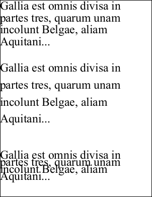

# LineSpacing Property

| Type | Default | Read Only | Description |
| --- | --- | --- | --- |
| `double` | 0.0 | No | The inter-line spacing. |

## Notes

Allows you to adjust the distance between lines of text.

At the start of every new line of text, the text drawing position is shifted vertically by the distance specified in this property. If the value is positive this will space the lines out. If the value is negative it will shift the lines together.

You can use the following code to adopt the linespacing from an embedded font.

```csharp
FontObject font = (FontObject)doc.ObjectSoup[doc.Font];
doc.TextStyle.LineSpacing = (font.FontLineSpacing * doc.TextStyle.Size) / 1000;
```

## Example

In the following example we add three blocks of text to a document. The first block uses the default line spacing. The second block uses a positive value to space out the lines. The last block uses a negative value to shift the lines together.

```csharp
using var doc = new Doc();
string text = "Gallia est omnis divisa in partes tres, quarum unam incolunt Belgae, aliam Aquitani...";
doc.TextStyle.Size = 48;
doc.AddText(text);
doc.Rect.Move(0, -250);
doc.TextStyle.LineSpacing = 20;
doc.AddText(text);
doc.Rect.Move(0, -350);
doc.TextStyle.LineSpacing = -20;
doc.AddText(text);
doc.Save("stylelspace.pdf");
```

  
stylelspace.pdf
