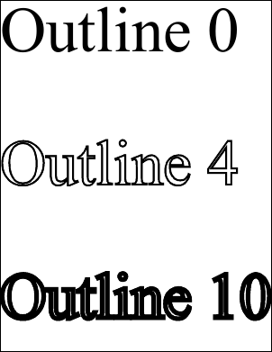

# Outline Property

| Type | Default | Read Only | Description |
| --- | --- | --- | --- |
| `double` | 0 | No | The width of character outlining. |

## Notes

This property determines whether a character outlining style is applied and the weight of the outline.

If the outline property is zero no outlining is done. If the outline property is greater than zero it indicates the width of lines used to outline the text.

This property draws a stroke around text as you add it. To convert the text already in a document to outlines, so that it no longer needs fonts, see [VectorizeTextOperation](../../../8-abcpdf.operations/l-vectorizetextoperation/index.md).

## Example

In this example we add some text to a document varying the outline style to show how different values affect the final result.

```csharp
using var doc = new Doc();
doc.TextStyle.Size = 144;
doc.AddText("Outline 0");
doc.Rect.Move(0, -300);
doc.TextStyle.Outline = 4;
doc.AddText("Outline 4");
doc.Rect.Move(0, -300);
doc.TextStyle.Outline = 10;
doc.AddText("Outline 10");
doc.Save("styleoutline.pdf");
```

  
styleoutline.pdf
