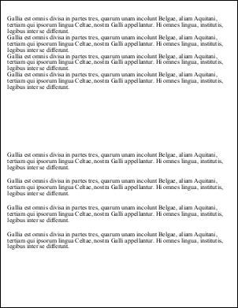

# ParaSpacing Property

| Type | Default | Read Only | Description |
| --- | --- | --- | --- |
| `double` | 0.0 | No | The inter-paragraph spacing. |

## Notes

Allows you to adjust the distance between paragraphs.

At the start of every new paragraph the text drawing position is shifted vertically by the distance specified in this property. If the value is positive this will space the paragraphs out. If the value is negative it will shift the paragraphs together.

## Example

In this example we add two blocks of text to a document. The first block uses the default paragraph spacing. The second block uses a positive value to space out the paragraphs.

```csharp
using var doc = new Doc();
string text = "Gallia est omnis divisa in partes tres, quarum unam incolunt Belgae, aliam Aquitani, tertiam qui ipsorum lingua Celtae, nostra Galli appellantur. Hi omnes lingua, institutis, legibus inter se differunt.";
text = text + "\r\n" + text + "\r\n" + text + "\r\n" + text;
doc.Rect.Inset(20, 40);
doc.TextStyle.Size = 16;
doc.AddText(text);
doc.Rect.Move(0, -350);
doc.TextStyle.ParaSpacing = 20;
doc.AddText(text);
doc.Save("stylepspace.pdf");
```

  
stylepspace.pdf

Also see example code in: [Doc TextStyle Property](../../doc/2-properties/textstyle.md), [XTextStyle Indent Property](indent.md).
