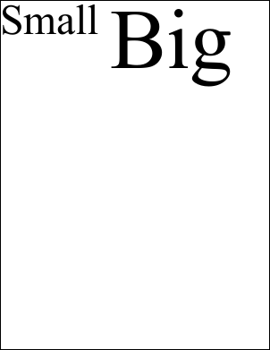

# Size Property

| Type | Default | Read Only | Description |
| --- | --- | --- | --- |
| `double` | 10.0 | No | The current text size. |

## Notes

This property determines the size of text that is added to the document using the [AddText](../../doc/1-methods/addtext.md) and [AddTextStyled](../../doc/1-methods/addtextstyled.md) methods.

The Size property is equivalent to the [Doc.FontSize](../../doc/2-properties/fontsize.md) property but unlike the FontSize property it allows fractional point sizes to be specified.

The font size is measured in units.

## Example

The following example adds two blocks of styled text to a document. The first block is in 96.5 point type and the second is in 192.5 point type.

```csharp
using var doc = new Doc();
doc.TextStyle.Size = 96.5;
doc.AddText("Small ");
doc.TextStyle.Size = 192.5;
doc.AddText("Big");
doc.Save("stylesize.pdf");
```

  
stylesize.pdf

Also see example code in: [ABCpdf Tagged Text Example](../../../4-examples/02-texttagged.md), [Doc TextStyle Property](../../doc/2-properties/textstyle.md), [XTagging Open Function](../../xtagging/1-methods/04-open.md), [XTagging Close Function](../../xtagging/1-methods/05-close.md), [XTextStyle AutoTag Property](autotag.md), [XTextStyle Bold Property](bold.md), [XTextStyle CharSpacing Property](charspacing.md), [XTextStyle Indent Property](indent.md), [XTextStyle Italic Property](italic.md), [XTextStyle Justification Property](justification.md), [XTextStyle Kerning Property](kerning.md), [XTextStyle LeftMargin Property](leftmargin.md), [XTextStyle LineSpacing Property](linespacing.md), [XTextStyle Outline Property](outline.md), [XTextStyle ParaSpacing Property](paraspacing.md), [XTextStyle Strike Property](strike.md), [XTextStyle Strike2 Property](strike2.md), [XTextStyle Underline Property](underline.md), [XTextStyle WordSpacing Property](wordspacing.md), [Page GetBitmap Function](../../../6-abcpdf.objects/page/1-methods/getbitmap.md).
