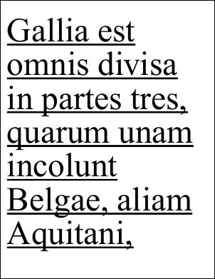

# Underline Property

| Type | Default | Read Only | Description |
| --- | --- | --- | --- |
| `bool` | false | No | Whether to underline text. |

## Notes

This property determines whether underlining is applied to text.

## Example

In this example we add some underlined text to a document.

```csharp
using var doc = new Doc();
string text = "Gallia est omnis divisa in partes tres, quarum unam incolunt Belgae, aliam Aquitani, tertiam qui ipsorum lingua Celtae, nostra Galli appellantur.";
doc.Rect.Inset(20, 40);
doc.TextStyle.Size = 96;
doc.TextStyle.Underline = true;
doc.AddText(text);
doc.Save("styleunderline.pdf");
```

  
styleunderline.pdf

Also see example code in: [XTransform AngleUnit Property](../../xtransform/2-properties/angleunit.md).
