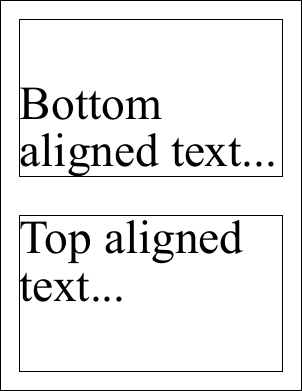

# VPos Property

| Type | Default Value | Read Only | Description |
| --- | --- | --- | --- |
| `double` | 0 | No | The current vertical positioning factor (0 to 1). |

## Notes

This property determines the vertical offset of blocks of text - used for bottom alignment, top alignment or middle alignment.

The offset is measured as a proportion of the distance from the top. A value of zero indicates top alignment, a value of one half indicates center aligned text and a value of one indicates bottom aligned text. Intermediate values can be used for intermediate offsets.

To horizontally align text use the [HPos](hpos.md) property. To justify text use the [Justification](justification.md) property.

## Example

The following code adds two blocks of text to a document. The first block is bottom aligned and the second is top aligned. Before adding the text we change the current rectangle and frame it so that you can see how the text is aligned.

```csharp
using var doc = new Doc();
doc.FontSize = 96;
doc.Rect.Magnify(1.0, 0.5);
doc.Rect.Inset(40, 40);
doc.FrameRect();
doc.AddText("Top aligned text...");
doc.Rect.Move(0, doc.Rect.Height + 80);
doc.FrameRect();
doc.TextStyle.VPos = 1.0;
doc.AddText("Bottom aligned text...");
doc.Save("docvpos.pdf");
```

  
docvpos.pdf

Also see example code in: [ABCpdf Deletion Example](../../../4-examples/05-deletion.md), [ABCpdf Headers and Footers Example](../../../4-examples/06-headers.md), [Doc AddPage Function](../../doc/1-methods/addpage.md), [Doc Append Function](../../doc/1-methods/append.md), [Doc Read Function](../../doc/1-methods/read.md), [Doc RemapPages Method](../../doc/1-methods/remappages.md), [XRendering SaveAlpha Property](../../xrendering/2-properties/savealpha.md), [XTransform AngleUnit Property](../../xtransform/2-properties/angleunit.md).
