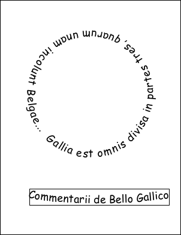

# RuneWidths Property

| Type | Default | Read Only | Description |
| --- | --- | --- | --- |
| `IDictionary<`[`XRune`](../../../5-abcpdf/xrune/index.md)`, int>` | n/a | Yes | The character widths indexed by rune. |

## Notes

The character widths in thousandths of a unit for all the characters in the font.

You can index the array by Unicode value. For example, to find the width of the letter 'a' which has an ASCII value of 65, you would access item 65 in the collection. The XRune class includes implicit and explicit conversions so typically you would index using int or char values. However it also includes support for characters outside the normal character range so you can support unusual characters like emojis.

Font subsetting may partially or fully remove certain characters from a font. ABCpdf tries to keep the Widths collection limited to entries for valid characters, but it is not always possible to determine definitively which characters remain. Therefore you should not assume that a character is present just because its width entry exists.

## Example

The example below shows how to add text on a curve and text flowing round a circle.

```csharp
string font = "Comic Sans MS";
string text = "Gallia est omnis divisa in partes tres, quarum unam incolunt Belgae...";
string theTitle = "Commentarii de Bello Gallico";
using var doc = new Doc();
doc.FontSize = 36;
doc.TextStyle.Kerning = XTextStyle.KerningType.None;
doc.Font = doc.EmbedFont(font, LanguageType.Latin, false, true, false);
// add some radial text in the top middle of the page
double cx = doc.MediaBox.Width * 0.5;
double cy = doc.MediaBox.Height * 0.6;
double r = doc.MediaBox.Width * 0.3;
CurvedText.AddRadial(doc, text, cx, cy, r, 225, true, false);
// add some curved text to a rectangle
double width = doc.MeasureText(theTitle);
doc.Rect.SetRect(100, 100, width, doc.FontSize * 1.5);
doc.FrameRect();
CurvedText2.AddCurved(doc, theTitle);
// save
doc.Save("ExampleCurvedText2.pdf");
```

```csharp
class CurvedText2 {
  public static void AddCurved(Doc doc, string text) {
    double halfWidth = doc.Rect.Width / 2;
    double height = doc.Rect.Height - doc.TextStyle.Size;
    double radius = ((halfWidth * halfWidth) + (height * height)) / (2 * height);
    double centerX = doc.Rect.Left + halfWidth;
    double centerY = doc.Rect.Bottom + radius + doc.TextStyle.Size;
    double alpha = Math.Asin(halfWidth / radius) - Math.PI;
    AddRadial(doc, text, centerX, centerY, radius, RadiansToDegrees(alpha), true, false);
  }

  public static void AddRadial(Doc doc, string text, double centerX, double centerY, double radius, double startAngleDegrees, bool inside, bool clockwise) {
    var font = doc.ObjectSoup[doc.Font] as FontObject;
    var widths = font.RuneWidths;
    int n = text.Length;
    double a = DegreesToRadians(startAngleDegrees);
    double fontWidthToRadians = doc.TextStyle.Size / (radius * 1000);
    doc.Rect.String = doc.MediaBox.String;
    for (int i = 0; i < n; i++) {
      // work out position
      double x = centerX + (Math.Sin(a) * radius);
      double y = centerY + (Math.Cos(a) * radius);
      // add a character
      doc.Pos.X = x;
      doc.Pos.Y = y;
      doc.Transform.Reset();
      double charRotation = inside ? RadiansToDegrees(-a) + 180 : RadiansToDegrees(-a);
      doc.Transform.Rotate(charRotation, x, y);
      doc.AddText(text[i].ToString());
      // increment angle
      var rune = new XRune(text[i]);
      double da = (double)widths[rune] * fontWidthToRadians;
      a += clockwise ? da : -da;
    }
    doc.Transform.Reset();
  }

  private static double DegreesToRadians(double degrees) {
    return degrees * Math.PI / 180;
  }

  private static double RadiansToDegrees(double radians) {
    return radians * 180 / Math.PI;
  }
}
```

  
ExampleCurvedText2.pdf
