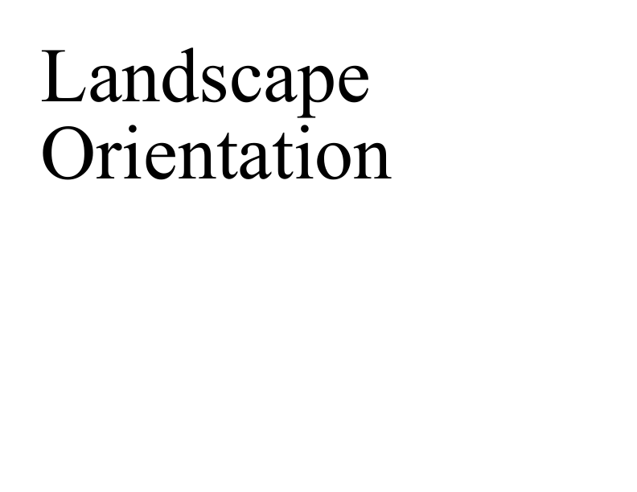
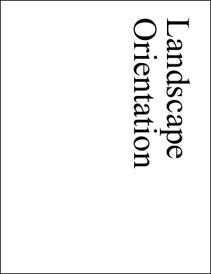

# Rotation Property

| Type | Default | Read Only | Description |
| --- | --- | --- | --- |
| `int` | n/a | No | The number of degrees to rotate the page before display. |

## Notes

The number of degrees clockwise to rotate the page before display.

The values 0 and 180 indicate portrait orientation. The values 90 and 270 indicate landscape orientation.

This value should be a multiple of 90.

## Example

This example shows how to use the Rotation property to determine how to add a PDF page - which may be rotated - to a portrait PDF page.

```csharp
using var doc = new Doc();
using var src = new Doc();
src.Read("landscape.pdf");
int rotation = ((Page)src.ObjectSoup[src.Page]).Rotation;
bool landscape = src.MediaBox.Width > src.MediaBox.Height;
doc.Page = doc.AddPage();   // output is always in portrait
if (landscape) {
  switch (rotation) {

    case 0:
    case 90:
      doc.Transform.Rotate(270, 0, 0);
      doc.Transform.Translate(0, doc.MediaBox.Height);
      break;
    case 180:
    case 270:
      doc.Transform.Rotate(90, 0, 0);
      doc.Transform.Translate(doc.MediaBox.Width, 0);
      break;
  }
  doc.Rect.SetRect(0, 0, doc.MediaBox.Height, doc.MediaBox.Width);
}
else {
  switch (rotation) {
    case 90:
    case 180:
      doc.Transform.Rotate(180, 0, 0);
      doc.Transform.Translate(doc.MediaBox.Width, doc.MediaBox.Height);
      break;
  }
}
doc.AddImageDoc(src, 1, null);
doc.Save("addtoportrait.pdf");
```

  
landscape.pdf

  
addtoportrait.pdf
