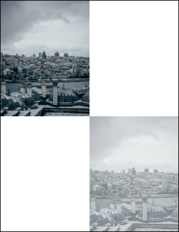

# SetAlpha Function

Sets a constant alpha value (0-255) for this image.

## Syntax

```csharp
void SetAlpha(double alpha)
```

## Params

| Name | Description |
| :---: | --- |
| alpha | A constant alpha value to assign to this image. |

## Notes

Assigns a constant alpha transparency to the PixMap.

The alpha value should range from 0 (fully transparent) to 255 (fully opaque). Any values outside this range will result in the alpha channel being removed.

## Example

Here we add an image without transparency and then, at a position down and to the right, with 50% transparency.

```csharp
using var doc = new Doc();
doc.Rect.Pin = XRect.Corner.TopLeft;
doc.Rect.Magnify(0.5, 0.5);
string path = "../mypics/mypic.jpg";
doc.AddImageFile(path, 1);
doc.Rect.Move(doc.Rect.Width, -doc.Rect.Height);
int i = doc.AddImageFile(path, 1);
var im = (ImageLayer)doc.ObjectSoup[i];
im.PixMap.SetAlpha(128);
doc.Save("pixmapsetalpha.pdf");
```

  
pixmapsetalpha.pdf
