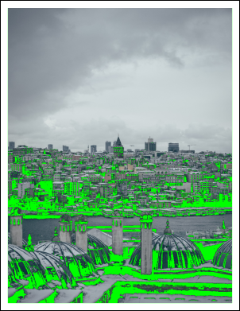

# SetChromakey Function

Sets a chromakey transparent color for this image.

## Syntax

```csharp
void SetChromakey(string chromakey)
```

## Params

| Name | Description |
| :---: | --- |
| chromakey | A chromakey string to assign to this image. |

## Notes

This allows you to assign a transparent color or color range to the image.

You need to specify two values for each component of the color. For a particular pixel, if all the components of the color fall within the specified ranges, then the pixel will not be displayed.

For example, to make pure white elements of an RGB transparent you might specify,

```csharp
doc.SetChromakey("255 255 255 255 255 255");
```

If you wanted to include colors which were off-white you might use,

```csharp
doc.SetChromakey("250 255 250 255 250 255");
```

This function is equivalent to setting the PixMap "/Mask" entry to an array of color values.

## Example

Here we add an image over the top of a green background. We use a chromakey to make black and near-black colors transparent.

```csharp
using var doc = new Doc();
doc.Rect.Inset(20, 20);
doc.Color.String = "0 255 0";
doc.FillRect();
string path = "../mypics/mypic.jpg";
int i = doc.AddImageFile(path, 1);
var im = (ImageLayer)doc.ObjectSoup[i];
im.PixMap.SetChromakey("0 50 0 50 0 50");
doc.Save("pixmapsetchromakey.pdf");
```

  
pixmapsetchromakey.pdf
