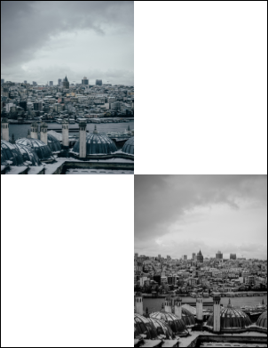

# ToGrayscale Function

Converts the image to grayscale.

## Syntax

```csharp
void ToGrayscale()
```

## Params

| Name | Description |
| :---: | --- |
| none |  |

## Notes

This allows you to convert an image to grayscale. It can be useful for preparing soft masks.

This function is a convenience method for this common operation. A practically identical effect can be achieved using the [Recolor](recolor.md) method followed by [Compress](../../streamobject/1-methods/compress.md).

## Example

Here we add an image in its natural color space and then, at a position down and to the right, converted to grayscale.

```csharp
using var doc = new Doc();
doc.Rect.Pin = XRect.Corner.TopLeft;
doc.Rect.Magnify(0.5, 0.5);
string path = "../mypics/mypic.jpg";
doc.AddImageFile(path, 1);
doc.Rect.Move(doc.Rect.Width, -doc.Rect.Height);
int i = doc.AddImageFile(path, 1);
var im = (ImageLayer)doc.ObjectSoup[i];
im.PixMap.ToGrayscale();
doc.Save("pixmaptograyscale.pdf");
```

  
pixmaptograyscale.pdf
