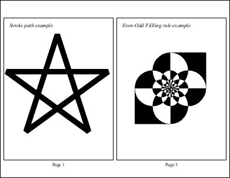
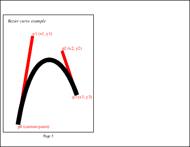

# Import Function

Imports a portion of an XPS document.

## Syntax

```csharp
void Import(Doc doc, string path)
```

*C#*

⚠ `may throw Exception()`

## Params

| Name | Description |
| :---: | --- |
| doc | The target PDF document. |
| path | The file path to the XPS document. |

## Notes

Imports an XPS or OXPS Document. By default, the entire XPS document is imported.

An exception will be thrown if the operation is not possible. This may happen if the XPS document is corrupt.

You may notice that colors in the PDF files are slightly different. PDF handles alpha blending differently from other file formats. Refer to [SwfImportOperation.Import](../../5-swfimportoperation/1-methods/import.md) for notes about alpha blending.

1. This method generates events as follows:

2. After the StartPart FixedDocumentSequence is opened, a [ProcessingObject](../../1-operation/3-events/1-processingobject.md) event of ProcessingSourceType.Document is generated.

   | Name | Description |
   | --- | --- |
   | ProcessingObjectEventArgs.Cancel | See ProcessingObjectEventArgs.Info.DocNumber below. |
   | [ProcessingObjectEventArgs.Info.Handled](../../2-processinginfo/2-properties/2-handled.md) | Ignored. |
   | [ProcessingObjectEventArgs.Info.SourceType](../../2-processinginfo/2-properties/1-sourcetype.md) | ProcessingSourceType.**Document** |
   | [ProcessingObjectEventArgs.Info.DocCount](../../2-processinginfo/2-properties/doccount.md) | The number of FixedDocument's in the FixedDocumentSequence. |
   | [ProcessingObjectEventArgs.Info.DocNumber](../../2-processinginfo/2-properties/docnumber.md) | The one-based document number of the FixedDocument to be processed. The value of this property for the first of such events for each FixedDocumentSequence is one unless [DocCount](../../2-processinginfo/2-properties/doccount.md) is zero. Subsequent value is the value returned by the event handler for the previous such event plus one if the new value is between 1 and [DocCount](../../2-processinginfo/2-properties/doccount.md) inclusively. Otherwise, it is null. The event handler may change this value between 1 and [DocCount](../../2-processinginfo/2-properties/doccount.md) inclusively. Set it to null to end the processing of all FixedDocument's in the FixedDocumentSequence. If it is null, the corresponding [ProcessedObject](../../1-operation/3-events/2-processedobject.md) event is not generated. Otherwise, if ProcessingObjectEventArgs.Cancel is set to true, the corresponding [ProcessedObject](../../1-operation/3-events/2-processedobject.md) event is not generated, and the same event is immediately generated again with this value incremented subject to mentioned bounds. |

3. After a previous [ProcessingObject](../../1-operation/3-events/1-processingobject.md) event of ProcessingSourceType.Document returns a proper [DocNumber](../../2-processinginfo/2-properties/docnumber.md) and the FixedDocument is opened, a [ProcessingObject](../../1-operation/3-events/1-processingobject.md) event of ProcessingSourceType.Page is generated.

   | Name | Description |
   | --- | --- |
   | ProcessingObjectEventArgs.Cancel | See ProcessingObjectEventArgs.Info.PageNumber below. |
   | [ProcessingObjectEventArgs.Info.Handled](../../2-processinginfo/2-properties/2-handled.md) | Ignored. |
   | [ProcessingObjectEventArgs.Info.SourceType](../../2-processinginfo/2-properties/1-sourcetype.md) | ProcessingSourceType.**Page** |
   | [ProcessingObjectEventArgs.Info.DocCount](../../2-processinginfo/2-properties/doccount.md) | The number of FixedDocument's in the FixedDocumentSequence. |
   | [ProcessingObjectEventArgs.Info.DocNumber](../../2-processinginfo/2-properties/docnumber.md) | The document number of the FixedDocument being processed. |
   | [ProcessingObjectEventArgs.Info.PageCount](../../2-processinginfo/2-properties/pagecount.md) | The number of FixedPage's in the FixedDocument. |
   | [ProcessingObjectEventArgs.Info.PageNumber](../../2-processinginfo/2-properties/pagenumber.md) | The one-based page number of the FixedPage to be processed. The value of this property for the first of such events for each FixedDocument is one unless [PageCount](../../2-processinginfo/2-properties/pagecount.md) is zero. Subsequent value is the value returned by the event handler for the previous such event plus one if the new value is between 1 and [PageCount](../../2-processinginfo/2-properties/pagecount.md) inclusively. Otherwise, it is null. The event handler may change this value between 1 and [PageCount](../../2-processinginfo/2-properties/pagecount.md) inclusively. Set it to null to end the processing of all FixedPage's in the FixedDocument. If it is null, the corresponding [ProcessedObject](../../1-operation/3-events/2-processedobject.md) event is not generated. Otherwise, if ProcessingObjectEventArgs.Cancel is set to true, the corresponding [ProcessedObject](../../1-operation/3-events/2-processedobject.md) event is not generated, and the same event is immediately generated again with this value incremented subject to mentioned bounds. |

4. After a previous [ProcessingObject](../../1-operation/3-events/1-processingobject.md) event of ProcessingSourceType.Page returns a proper [PageNumber](../../2-processinginfo/2-properties/pagenumber.md) and the FixedPage is opened, a [ProcessingObject](../../1-operation/3-events/1-processingobject.md) event of ProcessingSourceType.PageContent is generated.

   | Name | Description |
   | --- | --- |
   | ProcessingObjectEventArgs.Cancel | If this property is set to true, the page content is not rendered and the corresponding [ProcessedObject](../../1-operation/3-events/2-processedobject.md) event is not generated. |
   | [ProcessingObjectEventArgs.Info.Handled](../../2-processinginfo/2-properties/2-handled.md) | The value of this property is false when the event is generated. If it is false when the handler returns, a new page will be created in the target PDF document. The media box, crop box, and art box of the new page are set according to the information in the FixedPage, and the page content is rendered on to the entire page. Set this value to true to render the page content on to [Doc.Rect](../../../5-abcpdf/doc/2-properties/rect.md) of the current page using [Doc.Transform](../../../5-abcpdf/doc/2-properties/transform.md). |
   | [ProcessingObjectEventArgs.Info.SourceType](../../2-processinginfo/2-properties/1-sourcetype.md) | ProcessingSourceType.**PageContent** |
   | [ProcessingObjectEventArgs.Info.DocCount](../../2-processinginfo/2-properties/doccount.md) | The number of FixedDocument's in the FixedDocumentSequence. |
   | [ProcessingObjectEventArgs.Info.DocNumber](../../2-processinginfo/2-properties/docnumber.md) | The document number of the FixedDocument being processed. |
   | [ProcessingObjectEventArgs.Info.PageCount](../../2-processinginfo/2-properties/pagecount.md) | The number of FixedPage's in the FixedDocument. |
   | [ProcessingObjectEventArgs.Info.PageNumber](../../2-processinginfo/2-properties/pagenumber.md) | The page number of the FixedPage being processed. |
   | [ProcessingObjectEventArgs.Info.Width](../../2-processinginfo/2-properties/5-width.md) | The width of the FixedPage (as specified on the FixedPage element, not the one on the PageContent element) in 1/96 inches. |
   | [ProcessingObjectEventArgs.Info.Height](../../2-processinginfo/2-properties/5-width.md) | The height of the FixedPage (as specified on the FixedPage element, not the one on the PageContent element) in 1/96 inches. |

5. While processing page content, a [ProcessingObject](../../1-operation/3-events/1-processingobject.md) event of ProcessingSourceType.Image is generated when an image is imported.

   | Name | Description |
   | --- | --- |
   | ProcessingObjectEventArgs.Cancel | Ignored. |
   | [ProcessingObjectEventArgs.Info.Handled](../../2-processinginfo/2-properties/2-handled.md) | Ignored. |
   | [ProcessingObjectEventArgs.Info.SourceType](../../2-processinginfo/2-properties/1-sourcetype.md) | ProcessingSourceType.**Image** |
   | [ProcessingObjectEventArgs.Info.DocCount](../../2-processinginfo/2-properties/doccount.md) | The number of FixedDocument's in the FixedDocumentSequence. |
   | [ProcessingObjectEventArgs.Info.DocNumber](../../2-processinginfo/2-properties/docnumber.md) | The document number of the FixedDocument being processed. |
   | [ProcessingObjectEventArgs.Info.PageCount](../../2-processinginfo/2-properties/pagecount.md) | The number of FixedPage's in the FixedDocument. |
   | [ProcessingObjectEventArgs.Info.PageNumber](../../2-processinginfo/2-properties/pagenumber.md) | The page number of the FixedPage being processed. |
   | [ProcessingObjectEventArgs.Info.Width](../../2-processinginfo/2-properties/5-width.md) | The pixel width of the image. |
   | [ProcessingObjectEventArgs.Info.Height](../../2-processinginfo/2-properties/5-width.md) | The pixel height of the image. |

Unless stated otherwise, a [ProcessedObject](../../1-operation/3-events/2-processedobject.md) event corresponding to each [ProcessingObject](../../1-operation/3-events/1-processingobject.md) event is generated with an object as follows:

| [ProcessingObjectEventArgs.Info.SourceType](../../2-processinginfo/2-properties/1-sourcetype.md) | [ProcessedObjectEventArgs.Object](../../2-processedobjecteventargs/2-properties/object.md) when [successful](../../2-processedobjecteventargs/2-properties/successful.md) |
| :---: | --- |
| ProcessingSourceType.Document | null |
| ProcessingSourceType.Page | [GraphicLayer](../../../6-abcpdf.objects/graphiclayer/index.md) |
| ProcessingSourceType.PageContent | null |
| ProcessingSourceType.Image | [PixMap](../../../6-abcpdf.objects/pixmap/index.md) |

Imported images are not compressed. You may wish to analyse and compress these [PixMap](../../../6-abcpdf.objects/pixmap/index.md) objects by pre and post processing them during the [ProcessingObject](../../1-operation/3-events/1-processingobject.md) and [ProcessedObject](../../1-operation/3-events/2-processedobject.md) events.

## Example

Here we import the pages with odd page numbers of an XPS document up to page 8, 2 pages per sheet in landscape. The aspect ratio is preserved and a border is also drawn.

```csharp
using var doc = new Doc();
var importOp = new MyImportOperation(doc);
importOp.Import("../mypics/AdvancedGraphicsExamples.xps");
doc.Save("xps.pdf");
```

```csharp
class MyImportOperation {
  private Doc _doc = null;
  private double _margin = 10;
  private int _pagesAdded = 0;

  public MyImportOperation(Doc doc) {
    _doc = doc;

    _doc.Transform.Rotate(90, _doc.MediaBox.Left, _doc.MediaBox.Bottom);
    _doc.Transform.Translate(_doc.MediaBox.Width, 0);

    int id = _doc.GetInfoInt(_doc.Root, "Pages");
    _doc.SetInfo(id, "/Rotate", "90");
  }

  public void Import(string inPath) {
    using (XpsImportOperation op = new XpsImportOperation()) {
      op.ProcessingObject += Processing;
      op.ProcessedObject += Processed;
      op.Import(_doc, inPath);
    }
  }

  public void Processing(object sender, ProcessingObjectEventArgs e) {
    if (e.Info.SourceType == ProcessingSourceType.Page && e.Info.PageNumber != null) {
      if ((e.Info.PageNumber % 2) == 0)
        e.Info.PageNumber++;

      if (e.Info.PageNumber >= 8)
        e.Info.PageNumber = null;

      e.Tag = e.Info.PageNumber;
    }
    else if (e.Info.SourceType == ProcessingSourceType.PageContent) {
      if ((_pagesAdded % 2) == 0)
        _doc.Page = _doc.AddPage();

      double width = _doc.MediaBox.Height;
      double height = _doc.MediaBox.Width;
      double scale = Math.Min((width - 4 * _margin) / (2 * e.Info.Width.Value),
        (height - 2 * _margin) / e.Info.Height.Value);

      double rectWidth = scale * e.Info.Width.Value;
      double rectHeight = scale * e.Info.Height.Value;

      double distanceX = (width - 2 * rectWidth) / 3;
      double distanceY = (height - rectHeight) / 2;

      _doc.Rect.SetRect(distanceX + (_pagesAdded % 2) * (distanceX + rectWidth),
        distanceY, rectWidth, rectHeight);

      e.Info.Handled = true;
      _pagesAdded++;
    }
  }

  public void Processed(object sender, ProcessedObjectEventArgs e) {
    if (e.Successful) {
      var pixmap = e.Object as PixMap;
      if (pixmap != null)
        pixmap.Compress();

      var graphic = e.Object as GraphicLayer;
      if (graphic != null) {
        _doc.FrameRect();

        int pageNumber = (int)e.Tag;
        _doc.FontSize = 16;
        _doc.TextStyle.HPos = 0.5;
        _doc.Rect.Top = _doc.Rect.Bottom - _margin;
        _doc.Rect.Bottom = _doc.MediaBox.Bottom;
        _doc.AddText(string.Format("Page {0}", pageNumber));
      }
    }
  }
}
```

 
