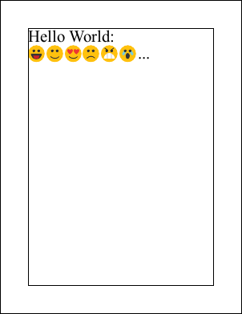

# CustomFont Function

## Syntax

[C#]

```csharp
<a href="../default.htm">CustomFont</a>()<a href="../default.htm">CustomFont</a>(Doc icons, char first)
```

## Params

| **Name** | **Description** |
| --- | --- |
| icons | The doc containing the icons |
| first | The character to be used for the first page. The character is incremented for subsequent pages. |

## Notes

Create a [CustomFont](default.md).

If you provide a Doc, each page will be turned into an icon. The icon sizes are taken from the Media Box for each page.

If there are bookmarks in the document these can be used to specify a Unicode value in hex format such as "0x2e00".

## Example

This example shows how to create a font Doc from a set of SVG files for use as the basis of a custom font. For an example showing how to use the emojifont.pdf document see the [Embed](02-embed.md) method.

[C#]

```csharp
using var doc = new Doc();
string icons = "../Rez/icons";
CustomFontMaker.Append(doc, icons, "happy-svgrepo-com.svg", 0x1F600);
CustomFontMaker.Append(doc, icons, "smiling-svgrepo-com.svg", 0x1F601);
CustomFontMaker.Append(doc, icons, "in-love-svgrepo-com.svg", 0x1F60D);
CustomFontMaker.Append(doc, icons, "sad-svgrepo-com.svg", 0x1F614);
CustomFontMaker.Append(doc, icons, "angry-svgrepo-com.svg", 0x1F620);
CustomFontMaker.Append(doc, icons, "crying-svgrepo-com.svg", 0x1F62F);
CustomFontMaker.Baseline(doc, 0.2);
doc.Save("emojifont.pdf");
```


emojis.pdf

