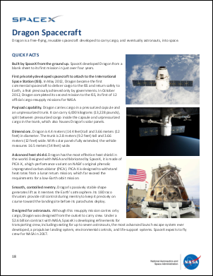

# Tag Function

Tags a PDF document using AI.

## Syntax

```csharp
Doc Tag(Python.PythonScope scope, string path, XReadOptions options = null)
```

## Params

| Name | Description |
| :---: | --- |
| scope | The Python scope for running code. |
| path | The file path to the PDF document. |
| options | The settings for the read. |
| return | The tagged PDF document. |

## Notes

Tags a PDF document. This method sets [XSaveOptions.AutoTag](../../../5-abcpdf/xsaveoptions/2-properties/autotag.md) of [Doc.SaveOptions](../../../5-abcpdf/doc/2-properties/saveoptions.md) to true.

New tags are created only when the document is saved to a file or is serialized.

## Example

This example shows a simple document tagging operation.

```csharp
var options = new PythonOptions();
options.Initialize(PythonEnvironment.Current, null);
using var rt = PythonEnvironment.Current.GetRuntime();
using var scope = rt.CreateScope();
rt.StdOutWriter = Console.Out;
rt.StdErrWriter = Console.Error;
rt.AutoInitializeRuntime(scope);
var p = Environment.OSVersion.Platform;
bool isWindows = p == PlatformID.Win32NT || p == PlatformID.Win32S || p == PlatformID.Win32Windows;
if (!isWindows)
  scope.Exec("import os\nos.environ['NO_COLOR'] = '1'\n");
var op = new AccessibilityOperationAI();
using var doc = op.Tag(scope, "../Rez/spacex_nasa_dragon.pdf");
doc.Save("accessibility_ai.pdf");
```

  
accessibility_ai.pdf
