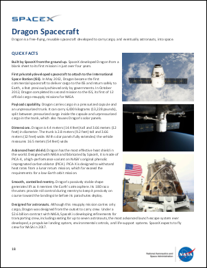

# ConversionOptions Property

| Type | Default Value | Read Only | Description |
| --- | --- | --- | --- |
| `string` | null | No | A Python expression that will be evaluated to be used as options for the conversion. |

## Notes

A Python expression that will be evaluated to be used as options for the conversion.

For Docling it is used as the format_options parameter to the DocumentConverter constructor.

## Example

Older Nvidia graphics cards may cause Python on Linux to crash. To use CPU instead of GPU and also to disable ANSI color in stdout output on Linux, you can use code of this form.

```csharp
string venvPath = null;
var options = new PythonOptions { SetNoSiteFlag = !string.IsNullOrEmpty(venvPath) };
options.Initialize(PythonEnvironment.Current, null);
using var rt = PythonEnvironment.Current.GetRuntime();
using var scope = rt.CreateScope();
rt.StdOutWriter = Console.Out;
rt.StdErrWriter = Console.Error;
rt.AutoInitializeRuntime(scope);
var p = Environment.OSVersion.Platform;
bool isWindows = p == PlatformID.Win32NT || p == PlatformID.Win32S || p == PlatformID.Win32Windows;
scope.Exec((isWindows ? "" : "import os\nos.environ['NO_COLOR'] = '1'\n") +
  "from docling.datamodel.accelerator_options import AcceleratorDevice, AcceleratorOptions\n" +
  "from docling.datamodel.base_models import InputFormat\n" +
  "from docling.datamodel.pipeline_options import ThreadedPdfPipelineOptions\n" +
  "from docling.document_converter import PdfFormatOption\n");
var op = new AccessibilityOperationAI();
op.ConversionOptions = "{InputFormat.PDF: PdfFormatOption(pipeline_options=ThreadedPdfPipelineOptions(do_ocr=False, accelerator_options=AcceleratorOptions(device=AcceleratorDevice.CPU)))}";
using var doc = op.Tag(scope, "../Rez/spacex_nasa_dragon.pdf");
doc.Save("accessibility_ai_cpu.pdf");
```

  
accessibility_ai_cpu.pdf

Also see example code in: [PythonScope SetAfterEval Function](../../../9-abcpdf.python/06-pythonscope/1-methods/10-setaftereval.md).
