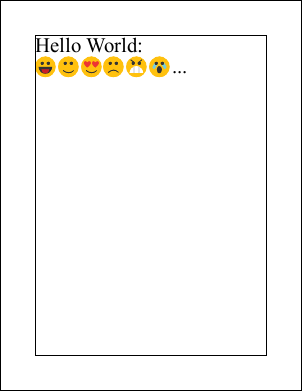

# CustomFont Function

Create a [CustomFont](../index.md) from a Doc containing one icon per page.

## Syntax

*C#*

[`CustomFont`](../index.md)`()`  
[`CustomFont`](../index.md)`(Doc icons, char first)`

⚠ `Exception:`

## Params

| Name | Description |
| :---: | --- |
| icons | The doc containing the icons |
| first | The character to be used for the first page. The character is incremented for subsequent pages. |

## Notes

Create a [CustomFont](../index.md).

If you provide a Doc, each page will be turned into an icon. The icon sizes are taken from the Media Box for each page.

If there are bookmarks in the document these can be used to specify a Unicode value in hex format such as "0x2e00".

## Example

This example shows how to create a font Doc from a set of SVG files for use as the basis of a custom font. For an example showing how to use the emojifont.pdf document see the [Embed](02-embed.md) method.

```csharp
using var doc = new Doc();
string icons = "../Rez/icons";
CustomFontMaker.Append(doc, icons, "happy-svgrepo-com.svg", 0x1F600);
CustomFontMaker.Append(doc, icons, "smiling-svgrepo-com.svg", 0x1F601);
CustomFontMaker.Append(doc, icons, "in-love-svgrepo-com.svg", 0x1F60D);
CustomFontMaker.Append(doc, icons, "sad-svgrepo-com.svg", 0x1F614);
CustomFontMaker.Append(doc, icons, "angry-svgrepo-com.svg", 0x1F620);
CustomFontMaker.Append(doc, icons, "crying-svgrepo-com.svg", 0x1F62F);
CustomFontMaker.Baseline(doc, 0.2);
doc.Save("emojifont.pdf");
```

```csharp
class CustomFontMaker {
  public static void Append(Doc doc, string dir, string file, int unicode) {
    using var icon = new Doc();
    icon.Read(Path.Combine(dir, file));
    doc.Append(icon);
    doc.PageNumber = doc.PageCount;
    doc.AddBookmark($"0x{unicode:X}", false);
  }
  public static void Baseline(Doc doc, double baseline) {
    var pages = doc.ObjectSoup.Catalog.Pages.GetPageArrayAll();
    var bbox = new XRect();
    foreach (var page in pages)
      bbox.Union(page.MediaBox);
    var scale = new XTransform(1, 0, 0, 1, 0, -bbox.Top * baseline);
    foreach (var page in pages) {
      doc.Page = page.ID;
      var layers = page.GetLayers();
      if (layers.Length > 0) {
        // scale contents
        var contents = (ArrayAtom)page.Resolve(Atom.GetItem(page.Atom, "Contents"));
        var restore = new StreamObject(doc.ObjectSoup, Encoding.ASCII.GetBytes($" Q"));
        contents.Insert(layers.Length, new RefAtom(restore));
        var save = new StreamObject(doc.ObjectSoup, Encoding.ASCII.GetBytes($"q {scale.String} cm "));
        contents.Insert(0, new RefAtom(save));
        // update page boundaries
        page.MediaBox.Union(XRect.FromPoints(scale.TransformPoints(page.MediaBox.GetCorners())));
        if (page.CropBox != null)
          page.CropBox.Union(XRect.FromPoints(scale.TransformPoints(page.CropBox.GetCorners())));
        if (page.ArtBox != null)
          page.ArtBox.Union(XRect.FromPoints(scale.TransformPoints(page.ArtBox.GetCorners())));
        if (page.BleedBox != null)
          page.BleedBox.Union(XRect.FromPoints(scale.TransformPoints(page.BleedBox.GetCorners())));
      }
    }
  }
}
```

  
emojis.pdf
