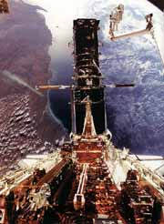
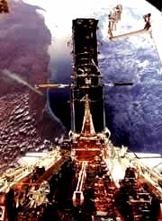
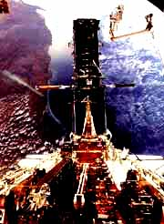
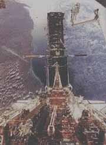

# Contrast Effect

The Contrast effect can be used to increase or decrease the contrast of an image.

## Settings

| Name | Default | Description |
| --- | --- | --- |
| Amount | 0 % | Amount to increase or decrease contrast by. |

## Workings

The value given is used to stretch the contrast within the image. Values greater than zero increase the amount of contrast while those less than zero decrease the contrast.

## Example

The following show the effect of increasing and decreasing contrast.

```csharp
void function() {
  using (Doc doc = new Doc()) {
    AddImagePage(doc, img2); // original image
    doc.Rendering.Save("EffectContrast.jpg");
    using (ImageLayer layer = AddImagePage(doc, img2)) {
      using (EffectOperation effect = new EffectOperation("Contrast")) {
        effect.Parameters["Amount"].Value = 25;
        effect.Apply(layer.PixMap);
      }
    }
    doc.Rendering.Save("EffectContrast25.jpg");
    using (ImageLayer layer = AddImagePage(doc, img2)) {
      using (EffectOperation effect = new EffectOperation("Contrast")) {
        effect.Parameters["Amount"].Value = 50;
        effect.Apply(layer.PixMap);
      }
    }
    doc.Rendering.Save("EffectContrast50.jpg");
    using (ImageLayer layer = AddImagePage(doc, img2)) {
      using (EffectOperation effect = new EffectOperation("Contrast")) {
        effect.Parameters["Amount"].Value = -50;
        effect.Apply(layer.PixMap);
      }
    }
    doc.Rendering.Save("EffectContrast-50.jpg");
  }
}
```

|  |  |
| --- | --- |
| <br>Original Image | <br>Contrast Amount 25 |
| <br>Contrast Amount 50 | <br>Contrast Amount -50 |
